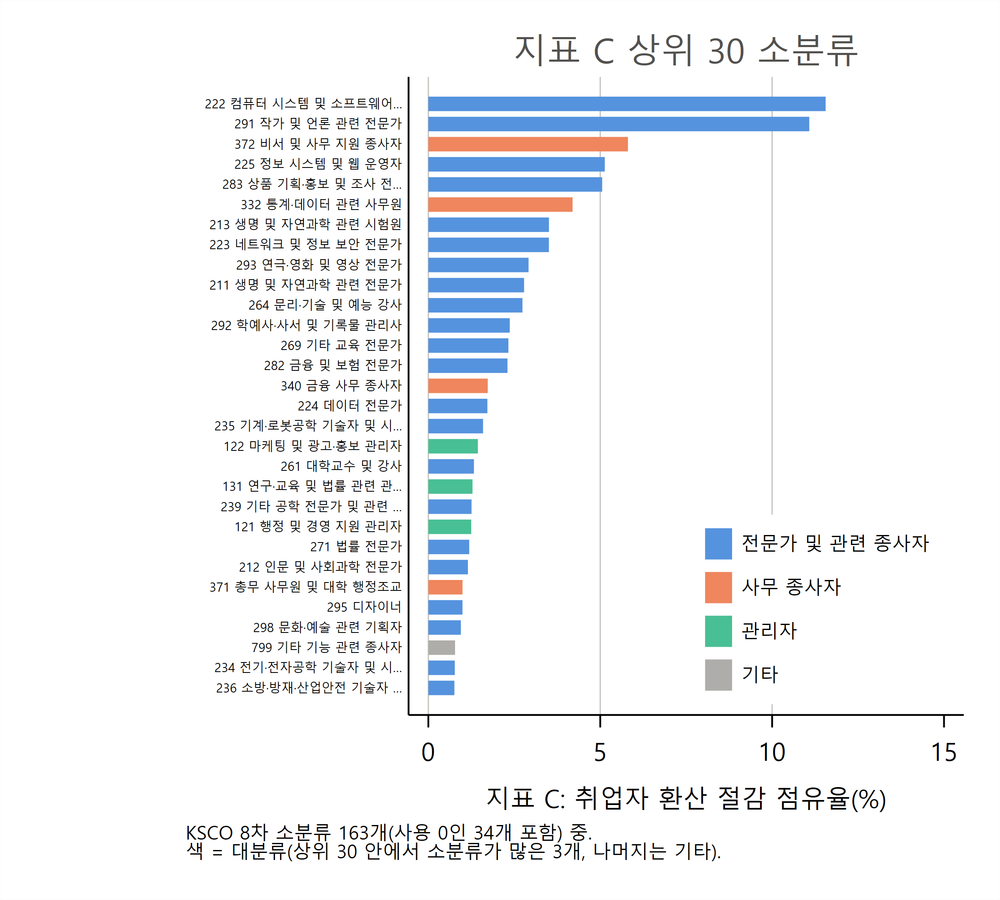

# 점유율 지표 A·B·C 상위 30·하위 30 직업 엑셀 파일 설명

**SOC 세부 직업과 KSCO 세분류·소분류·중분류·대분류**

AI-effects 프로젝트

> 이 문서는 같은 이름의 `.tex`와 같은 내용이다. 표 수치는 `results/table/34_*.tex`(code/04_17_analysis_kor_share_top30.do 생성)를 옮긴 것이다.

## 요약

이 노트는 `results/table/34_kor_share_top30.xlsx`(상위 30)와 `34_kor_share_bottom30.xlsx`(하위 30)를 설명한다. 두 파일은 `code/04_17_analysis_kor_share_top30.do`가 한 번에 만들고, 시트 구성과 열이 같다. 각 시트는 한 분류 단계에서 지표 하나로 직업을 줄 세운 목록이다. 분류 단계는 SOC 세부 직업, KSCO 8차 세분류·소분류·중분류·대분류다. 지표는 paper 27의 점유율 지표 A(업무용 대화 점유율), B(절감 시간 점유율), C(취업자 환산 절감 점유율)다. KSCO 시트에는 그 직업의 값에 가장 많이 기여한 한 단계 아래 직업(기여 1위)과 그 몫을 함께 적었다.

- **시트 11개**: SOC 2개(A, B), 세분류 2개(A, B), 소분류 3개(A, B, C), 중분류 3개(A, B, C), 대분류 1개(9개 전부). 세분류에는 C가 없다. C의 분모인 1인당 근로시간이 소분류에만 있기 때문이다.
- **값은 다른 paper와 같다.** 소분류·중분류·대분류 값은 `03_05`의 지표 그대로다. 세분류 값은 같은 규칙으로 새로 만들었고, 소분류 안 세분류를 더하면 소분류 값과 같다(do 파일에서 assert).
- **쏠림이 크다.** 상위 30개의 점유율 합은 SOC·세분류에서 59~60%, 소분류에서 81~84%다. 소분류 1·2위는 A에서 291 작가 및 언론 관련 전문가, 222 컴퓨터 시스템 및 소프트웨어 전문가이고, B·C에서는 순서가 바뀐다.
- **하위 30은 해석에 주의가 필요하다.** 값이 0.001% 안팎으로 작아 AEI 공개 비중의 최소 단위, 한 달만 공개된 직업, 연계표에서 SOC 하나만 이어진 직업의 영향을 크게 받는다. 4절에 점검 수치를 모았다.

## 1. 두 파일과 시트 구성

두 파일의 시트 이름과 열은 같다. 상위 파일은 값이 큰 순(첫 열 "순위", 1 = 가장 큼), 하위 파일은 값이 작은 순(첫 열 "하위 순위", 1 = 가장 작음)이다. 같은 값은 코드 순으로 순위를 매겼다. 대분류 시트(`ksco1`)는 9개 전부를 담으므로 두 파일의 내용이 같고 정렬 방향만 다르다.

**표 1. 시트 구성: 대상 수와 목록에 든 직업의 점유율 합**

| 시트 | 분류 단계 | 기준 지표 | 대상 수 | 목록 수 | 상위 목록 합(%) | 하위 목록 합(%) |
|---|---|---|---|---|---|---|
| `soc_A` | SOC 세부 직업 | 지표 A | 368 | 30 | 58.6 | 0.11 |
| `soc_B` | SOC 세부 직업 | 지표 B | 368 | 30 | 59.8 | 0.04 |
| `ksco4_A` | KSCO 세분류 | 지표 A | 338 | 30 | 59.6 | 0.03 |
| `ksco4_B` | KSCO 세분류 | 지표 B | 338 | 30 | 60.2 | 0.01 |
| `ksco3_A` | KSCO 소분류 | 지표 A | 129 | 30 | 81.3 | 0.44 |
| `ksco3_B` | KSCO 소분류 | 지표 B | 129 | 30 | 84.1 | 0.22 |
| `ksco3_C` | KSCO 소분류 | 지표 C | 129 | 30 | 84.4 | 0.22 |
| `ksco2_A` | KSCO 중분류 | 지표 A | 50 | 30 | 98.0 | 6.08 |
| `ksco2_B` | KSCO 중분류 | 지표 B | 50 | 30 | 98.9 | 4.01 |
| `ksco2_C` | KSCO 중분류 | 지표 C | 50 | 30 | 98.9 | 4.08 |
| `ksco1` | KSCO 대분류 | 지표 A | 9 | 9 | 100.0 | 100.00 |

각 시트의 열은 다음과 같다(요청 목록 순서).

- `soc_A`, `soc_B`: 순위, SOC 코드, SOC 직업명(BLS), 기준 지표, 다른 지표(A 시트는 A, B 순, B 시트는 B, A 순).
- `ksco4_A`, `ksco4_B`: 순위, KSCO 세분류 코드, 직업명, 기준 지표, 다른 지표, 기여 1위 SOC, 그 몫(%).
- `ksco3_*`, `ksco2_*`: 순위, 코드, 직업명, 기준 지표, 나머지 두 지표, 기여 1위 하위 직업(소분류 시트는 세분류, 중분류 시트는 소분류), 그 몫(%).
- `ksco1`: 지표 A 순위, 코드, 직업명, A, B, C, B 순위, C 순위, 지표별 기여 1위 중분류와 그 몫(%) 세 쌍.

엑셀의 값은 반올림하지 않은 % 값이다. 직업명은 SOC는 BLS 영문 명칭, KSCO는 통계청 명칭이다.

## 2. 지표 정의

기간은 AEI 한국 자료의 2026년 4월과 5월이다. 두 달은 월별 비중을 구한 뒤 단순평균했고, 공개되지 않은 달은 0으로 두었다(paper 19, 27과 같은 규칙).

**SOC 세부 직업.** 지표 A는 한국 업무용 대화 중 그 SOC의 비중이다.

- A_s = 100 × ½ Σ_t share_work_st

지표 B는 업무용 비중에 대화당 절감 시간(AEI GLOBAL 값, 분)을 곱한 값 saved_w_st의 점유율이다.

- B_s = 100 × ½ Σ_t saved_w_st / Σ_s' saved_w_s't

A는 농림어업 세부 직업 미공개 몫을 모은 자리표시 행 45-XXXX까지 더해 100이다. 45-XXXX는 순위에서 뺐다. 이 행에는 절감 시간이 없어 B에는 처음부터 들어가지 않는다.

**KSCO 세분류(4자리).** SOC 단계 값을 SOC 2018–KSCO 8차 연계표의 배분 몫 w_sk(paper 21의 `w_alloc`)로 나눠 붙였다.

- A_k = 100 × ½ Σ_t (Σ_s share_work_st × w_sk) / T^A_t
- B_k = 100 × ½ Σ_t (Σ_s saved_w_st × w_sk) / T^B_t

T_t는 `03_05`가 소분류 지표 표본(129개)으로 정규화할 때 쓴 월 t의 합이다. 그래서 소분류 안 세분류 값을 더하면 소분류의 A, B와 정확히 같다. 대상은 지표 표본 소분류에 속하고 연결된 SOC 중 한국 비중이 공개된 것이 있는 세분류 338개다.

**KSCO 소분류·중분류·대분류.** `kor_ai_usage_ksco{3,2,1}`의 `shA`, `shB`, `shC`를 그대로 썼다(paper 27). 지표 C는 B를 소분류의 1인당 월 주업 근로시간(지역별고용조사 2022 상반기)으로 나눠 다시 정규화한 값이다. 즉 절감 시간을 일하는 사람 수로 바꾼 점유율이다. 중분류·대분류 값은 소분류 값의 합이다.

**기여 1위.** 시트의 기준 지표로 정한다.

- 세분류 ← SOC: A 시트는 share_work × w_sk, B 시트는 saved_w × w_sk가 가장 큰 SOC.
- 소분류 ← 세분류: A 시트는 세분류 A, B·C 시트는 세분류 B가 가장 큰 세분류. 소분류 안에서는 1인당 근로시간이 같으므로 C의 몫은 B의 몫과 같다.
- 중분류 ← 소분류, 대분류 ← 중분류: 각 지표 값이 가장 큰 하위 직업.

몫(%)은 기여 1위의 값을 그 직업 값으로 나눈 것이다. 50%를 넘으면 그 직업의 값은 사실상 하위 직업 하나가 정한다.

## 3. 결과 개관

**표 2. KSCO 소분류 상위 10: 지표 A, B, C(%)**

|   | 지표 A 순 | A | 지표 B 순 | B | 지표 C 순 | C |
|---|---|---|---|---|---|---|
| 1 | 291 작가 및 언론 관련 전문가 | 11.92 | 222 컴퓨터 시스템 및 소프트웨어 전문가 | 12.21 | 222 컴퓨터 시스템 및 소프트웨어 전문가 | 11.56 |
| 2 | 222 컴퓨터 시스템 및 소프트웨어 전문가 | 9.95 | 291 작가 및 언론 관련 전문가 | 10.47 | 291 작가 및 언론 관련 전문가 | 11.08 |
| 3 | 225 정보 시스템 및 웹 운영자 | 8.32 | 225 정보 시스템 및 웹 운영자 | 5.34 | 372 비서 및 사무 지원 종사자 | 5.81 |
| 4 | 372 비서 및 사무 지원 종사자 | 4.69 | 372 비서 및 사무 지원 종사자 | 5.24 | 225 정보 시스템 및 웹 운영자 | 5.13 |
| 5 | 283 상품 기획‧홍보 및 조사 전문가 | 4.20 | 283 상품 기획‧홍보 및 조사 전문가 | 5.15 | 283 상품 기획‧홍보 및 조사 전문가 | 5.06 |
| 6 | 223 네트워크 및 정보 보안 전문가 | 3.84 | 332 통계‧데이터 관련 사무원 | 4.03 | 332 통계‧데이터 관련 사무원 | 4.20 |
| 7 | 292 학예사‧사서 및 기록물 관리사 | 3.81 | 223 네트워크 및 정보 보안 전문가 | 3.74 | 213 생명 및 자연과학 관련 시험원 | 3.51 |
| 8 | 213 생명 및 자연과학 관련 시험원 | 2.79 | 213 생명 및 자연과학 관련 시험원 | 3.62 | 223 네트워크 및 정보 보안 전문가 | 3.51 |
| 9 | 332 통계‧데이터 관련 사무원 | 2.61 | 211 생명 및 자연과학 관련 전문가 | 2.89 | 293 연극‧영화 및 영상 전문가 | 2.91 |
| 10 | 340 금융 사무 종사자 | 2.61 | 293 연극‧영화 및 영상 전문가 | 2.85 | 211 생명 및 자연과학 관련 전문가 | 2.78 |

소분류 상위 10은 정보 통신·글쓰기·사무 지원·연구 직업으로 세 지표가 거의 같다. 차이는 대화당 절감 시간에서 나온다(paper 31). 225 정보 시스템 및 웹 운영자는 A 3위(8.32%)지만 대화당 절감 시간이 짧아 B 5.34%로 줄어든다. 332 통계·데이터 관련 사무원은 반대로 A 9위에서 B·C 6위로 오른다. C는 B를 1인당 근로시간으로 나눈 값이라 B와 순서가 거의 같다. 372 비서 및 사무 지원 종사자는 225보다 1인당 근로시간이 짧아 C에서 225를 앞서 3위가 된다. 상위 30 겹침은 A와 B, A와 C 모두 26개다(표 4).

그림 1은 `ksco3_C` 시트의 상위 30 전체를 막대로 그린 것이다. 1·2위(222, 291)가 각각 11% 남짓으로 3위 이하의 두 배가 넘고, 막대 색으로 보면 상위 30 대부분이 전문가(대분류 2)이며 사무(3)와 관리자(1)가 그 뒤를 잇는다.

**그림 1. 지표 C 상위 30 소분류(색 = 대분류)**

**표 3. KSCO 대분류: 지표 A, B, C(%, 괄호는 순위)와 지표 A 기여 1위 중분류(몫, %)**

|   | 대분류 | A | B | C | 지표 A 기여 1위 중분류 |
|---|---|---|---|---|---|
| 1 | 2 전문가 및 관련 종사자 | 70.50 | 72.18 (1) | 71.88 (1) | 22 정보 통신 전문가 및 기술직 (33.8) |
| 2 | 3 사무 종사자 | 14.64 | 14.40 (2) | 15.05 (2) | 37 일반 지원 사무직 (41.1) |
| 3 | 1 관리자 | 6.86 | 8.89 (3) | 8.37 (3) | 13 전문 서비스 관리직 (39.7) |
| 4 | 5 판매 종사자 | 3.17 | 1.25 (5) | 1.20 (5) | 52 매장 판매 및 상품 대여직 (60.2) |
| 5 | 7 기능원 및 관련 기능 종사자 | 1.94 | 1.42 (4) | 1.55 (4) | 79 기타 기능 관련직 (43.6) |
| 6 | 4 서비스 종사자 | 1.10 | 0.52 (7) | 0.60 (7) | 41 경찰‧소방 및 보안 관련 서비스직 (34.5) |
| 7 | 8 장치∙기계 조작 및 조립 종사자 | 0.88 | 0.97 (6) | 0.88 (6) | 85 기계 제조‧관련 기계 조작 및 조립직 (72.7) |
| 8 | 9 단순노무 종사자 | 0.88 | 0.36 (8) | 0.47 (8) | 99 농림어업 및 기타 서비스 단순 노무직 (53.0) |
| 9 | 6 농림∙어업 숙련 종사자 | 0.03 | 0.00 (9) | 0.00 (9) | 61 농축산 숙련직 (78.7) |

대분류에서는 전문가 및 관련 종사자가 A·B·C의 70% 이상을 차지하고, 그 안에서 22 정보 통신 전문가 및 기술직의 몫이 가장 크다. 관리자는 B·C에서 A보다 몫이 커지고, 판매·서비스·단순노무는 줄어든다. 9개 중 6개는 세 지표의 기여 1위 중분류가 같다. 다른 지표의 기여 1위는 `ksco1` 시트에 있다.

## 4. 읽을 때 유의사항

**표 4. 하위 목록과 기여 1위를 읽을 때 쓰는 점검 수치**

| 항목 | 값 |
|---|---|
| SOC 지표 A 최솟값(%) / 그 값을 가진 SOC 수 | 0.00124 / 6 |
| SOC 지표 B 최솟값(%) / 그 값을 가진 SOC 수 | 0.00017 / 1 |
| 세분류 지표 A 상위 30 중 기여 1위 SOC 몫이 50% 이상인 수 | 23 |
| 세분류 지표 A 하위 30 중 기여 1위 SOC 몫이 100%(SOC 하나)인 수 | 30 |
| 세분류 전체 중 기여 1위 SOC 몫이 100%인 수 | 115 / 338 |
| 소분류 중 한 달만 공개된 수 | 7 |
| 소분류 하위 30 중 한 달만 공개된 수(A / B / C) | 7 / 7 / 7 |
| 소분류 상위 30 겹침(A와 B / A와 C) | 26 / 26 |
| 대분류 중 A·B·C 기여 1위 중분류가 모두 같은 수 | 6 / 9 |

1. **SOC 지표 A의 하위권에는 동점이 있다.** 최솟값 0.00124%를 가진 SOC가 6개다. 이 값은 AEI가 공개한 한국 비중의 최소 단위로 보인다(공개 규칙은 확인하지 않았다). 동점 안 순서는 SOC 코드 순일 뿐이다. B는 SOC별 절감 시간을 곱하므로 최솟값을 가진 SOC가 하나뿐이다.
2. **소분류 하위 30에는 한 달만 공개된 소분류 7개가 모두 들어 있다**(A, B, C 모두). 비공개 달을 0으로 두고 두 달을 평균했기 때문에 값이 공개된 달의 절반이다. 이 소분류의 하위 순위는 사용이 적다는 뜻과 한 달만 공개됐다는 뜻이 섞여 있다.
3. **세분류 기여 1위는 연계표 배분을 그대로 보여 준다.** 세분류 338개 중 115개는 한국 비중이 공개된 SOC가 하나뿐이어서 기여 1위 몫이 100%다. 하위 30은 모두 그렇다. 예를 들어 9412 운송 및 시설장비 청소원과 9991 구두 미화원의 기여 1위는 39-4012 Crematory Operators이고, 2133 자연과학 시험원의 지표 B 기여 1위는 15-2051 Data Scientists다. 이런 연결은 연계표의 단계별 배분(paper 21)과, AEI 직업이 사용자의 직업이 아니라 대화 과업의 직업이라는 점에서 생긴다. 직업 간 비교에 쓰기 전에 연계 경로를 확인해야 한다.
4. **SOC 시트와 KSCO 시트의 합은 기준이 다르다.** SOC 값은 한국 업무용 대화 전체(45-XXXX 포함) 중 비중이고, KSCO 값은 소분류 지표 표본 129개 안에서 다시 정규화한 비중이다. 같은 대화라도 SOC 시트와 KSCO 세분류 시트의 숫자를 직접 더하거나 빼지 않는다.
5. **절감 시간은 추정치다.** B·C의 대화당 절감 시간은 AEI가 대화마다 추정한 "사람이 혼자 하면 걸릴 시간" − "AI와 함께 걸린 시간"의 GLOBAL 평균이다. 한국 대화에도 같은 값을 썼다.
6. **점유율은 수준이 아니다.** 모든 값은 한국 업무용 AI 대화(또는 절감 시간) 안에서의 몫이다. 직업 규모 대비 사용 강도는 상대 활용도 RU1·RU2(paper 25, 32)로 본다.

## 5. 산출 파일

- 코드: `code/04_17_analysis_kor_share_top30.do`(Stata 17, `00_master.do`에 포함). 입력은 `kor_soc6_conv_ai_indicators`(`03_03`), SOC 2018–KSCO 8차 연계표(`01_06`), `kor_ai_usage_ksco{3,2,1}`(`03_05`).
- 엑셀: `results/table/34_kor_share_top30.xlsx`, `34_kor_share_bottom30.xlsx`(시트 11개씩).
- 이 노트의 표: `results/table/34_sheets.tex`, `34_top10_ksco3.tex`, `34_ksco1.tex`, `34_notes.tex`.
- 그림: `results/figure/34_fig_ksco3_top30_C.{pdf,png}`(`code/04_20_analysis_kor_share_figures.do`).
