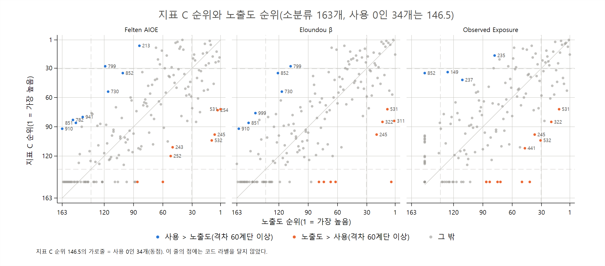

# AI 점유율 지표와 노출도의 순위 비교 엑셀 파일 설명

**KSCO 8차 소분류 163개, 지표 A·B·C와 Felten·Eloundou·Observed Exposure**

AI-effects 프로젝트

> 이 문서는 같은 이름의 `.tex`와 같은 내용이다. 표 수치는 `results/table/35_*.tex`(code/04_18_analysis_kor_share_exposure_rank.do 생성)를 옮긴 것이다.

## 요약

이 노트는 `results/table/35_kor_share_exposure_rank.xlsx`를 설명한다. 파일은 `code/04_18_analysis_kor_share_exposure_rank.do`가 만들고, 시트 7개로 되어 있다. 실제 사용을 나타내는 점유율 지표 A·B·C(paper 27)와 사전적 노출도 3개를 KSCO 8차 소분류 163개(사용 0인 34개 포함, 2026-11-01)에서 순위로 비교한다. 노출도는 Felten AIOE(언어모델)(Felten et al., 2021, 2023), Eloundou 노출도(GPT-4 β)(Eloundou et al., 2023), Observed Exposure(Massenkoff and McCrory, 2026)다.

- **시트**: Spearman 순위상관 1개, 노출도별 상위·하위 30과 지표 A·B·C 3개, 지표별 상위·하위 30과 노출도 3개 3개.
- **사용과 노출도의 순위상관은 0.73~0.75다.** 사용 지표끼리(0.98~1.00)나 노출도끼리(0.78~0.88)보다 낮다. 세 노출도 사이의 차이는 작다(paper 28과 같은 값). 사용 0인 34개는 대부분 노출도도 낮아, 이들을 넣으면 129개만 보던 이전 판(0.60~0.70)보다 상관이 오른다.
- **상위 30의 절반 정도만 겹친다.** 노출도 상위 30 중 지표 A·B·C 상위 30에도 드는 소분류는 Felten 15개, Eloundou 14개, Observed Exposure 17~18개다. 하위 목록 겹침은 15~21개다.
- **하위 목록은 동점과 공개 범위를 보고 읽어야 한다.** 같은 값에는 평균 순위를 준다. 지표 A·B·C의 하위 목록은 사용 0인 34개(146.5위로 동점)이고, Observed Exposure의 하위 목록은 값이 0인 28개(149.5위)와 그 위 2개다.

## 1. 파일 구성

**표 1. 시트 구성**

| 시트 | 내용 | 열 |
|---|---|---|
| `spearman` | 6개 지표의 Spearman 순위상관 | 위 6행은 순위상관(ρ), 아래 6행은 p값. 지표 순서는 A, B, C, Felten AIOE, Eloundou β, Observed Exposure. |
| `felten30` | Felten AIOE 상위·하위 30 | 구분(상위/하위), Felten 순위, KSCO 코드, 직업명, Felten 값, 지표 A, A 순위, 지표 B, B 순위, 지표 C, C 순위 |
| `elo30` | Eloundou β 상위·하위 30 | 같은 구성(Felten 대신 Eloundou β) |
| `oe30` | Observed Exposure 상위·하위 30 | 같은 구성(Observed Exposure) |
| `A30` | 지표 A 상위·하위 30 | 구분, KSCO 코드, 직업명, 지표 A, A 순위, Felten 값·순위, Eloundou β 값·순위, Observed Exposure 값·순위 |
| `B30` | 지표 B 상위·하위 30 | 같은 구성(지표 B) |
| `C30` | 지표 C 상위·하위 30 | 같은 구성(지표 C) |

- **표본**: 지표 A·B·C와 소분류 163개(paper 27·28과 같다). 한국 대화 비중이 두 달 모두 미공개인 34개는 사용 0(A = B = C = 0)이다. 순위는 모두 이 163개 안 순위다.
- **순위**: 값이 큰 순서(1 = 가장 큼)이고, 같은 값은 평균 순위다. 상위 30은 30번째와 같거나 높은 순위, 하위 30은 뒤에서 30번째와 같거나 낮은 순위라, 경계에 동점이 있으면 30개보다 많다(지표 A·B·C 하위 목록은 34개). 한 시트에 상위 30을 먼저, 하위 30을 다음에 순위 순으로 놓고 "구분" 열로 나눴다.
- **값**: 엑셀 값은 반올림하지 않았다. 지표 A·B·C는 %다.
- 요청 목록의 Observed Exposure 시트 열 "beta 값"은 Observed Exposure 값으로 했다. 노출도 시트에는 그 노출도의 순위 열을, 모든 상위·하위 시트에는 구분 열을 더했다.

## 2. 지표

**점유율 지표(실제 사용).** paper 27과 같다. AEI 한국 업무용 대화 비중(2026년 4·5월, 월별 비중의 단순평균)을 SOC 2018–KSCO 8차 연계표로 소분류에 배분했다.

- A: 업무용 대화 점유율.
- B: 절감 시간 점유율. 업무용 비중에 SOC별 대화당 절감 시간(AEI GLOBAL 추정)을 곱한 값의 점유율이다.
- C: 취업자 환산 절감 점유율. B를 소분류의 1인당 월 근로시간(지역별고용조사 2022 상반기)으로 나눠 다시 정규화했다.

**노출도(사전적 지표).** SOC 값을 연계표의 평균 가중치(`w_mean`)로 소분류에 평균했다(paper 23).

- Felten AIOE: 언어모델용 AI 직업 노출도. 표준화 점수라 음수가 있다(163개 중 82개).
- Eloundou β: GPT-4가 평가한 과업 노출도(E1 + 0.5 × E2의 직업 평균, 0~1).
- Observed Exposure: Eloundou β로 노출 가능한 과업 중 실제 Claude 업무 사용(Claude.ai 업무용 대화와 API, 자동화 사용에 더 큰 가중치)에서 관측된 과업의 몫(0~1). 0인 소분류가 13개다.

세 노출도는 "AI가 일을 할 수 있는가"를 재고, 점유율 지표는 "한국에서 실제로 AI 대화가 어디에 몰리는가"를 잰다. 노출도는 직업 규모와 상관없는 강도이고, 점유율은 직업 규모가 들어간 몫이라는 점도 다르다(paper 28, 32). 순위 비교는 이 차이를 그대로 담는다.

## 3. 결과 개관

### 3.1 순위상관

**표 2. Spearman 순위상관(소분류 163개, 사용 0인 34개 포함)**

|   | 지표 A | 지표 B | 지표 C | Felten | Eloundou β | Observed |
|---|---|---|---|---|---|---|
| 지표 A | 1 |  |  |  |  |  |
| 지표 B | 0.98 | 1 |  |  |  |  |
| 지표 C | 0.98 | 1.00 | 1 |  |  |  |
| Felten AIOE | 0.73 | 0.75 | 0.75 | 1 |  |  |
| Eloundou β | 0.74 | 0.75 | 0.75 | 0.88 | 1 |  |
| Observed Exposure | 0.73 | 0.73 | 0.73 | 0.78 | 0.83 | 1 |

모든 상관은 1% 수준에서 유의하다(p값은 엑셀 `spearman` 시트). 사용 지표와 노출도의 순위상관은 0.73~0.75로, 노출도가 높은 직업이 대체로 많이 쓰지만 순서는 상당히 다르다. B와 C는 순위상관이 1.00(반올림)으로 사실상 같은 순서다. 아래 사례에서 보듯 Felten은 판매·상담·교육 같은 대면 직업에도 높은 점수를 준다.

그림 1은 지표 C 순위를 세 노출도 순위와 점으로 비교한 것이다. 두 축 모두 1위가 오른쪽·위쪽이고, 대각선 위(왼쪽 위)는 사용 순위가 노출도 순위보다 높은 소분류, 아래(오른쪽 아래)는 그 반대다. 점선은 상위 30과 하위 30의 경계다. 격차가 60계단 이상인 소분류만 코드를 붙였다. 지표 C 순위 146.5의 가로줄은 사용 0인 34개다(코드를 붙이지 않았다).

**그림 1. 지표 C 순위와 노출도 순위(소분류 163개, 코드 = 격차 60계단 이상, 사용 0인 34개 제외)**

### 3.2 상위·하위 30의 겹침

**표 3. 노출도 상위·하위 30과 사용 지표 상위·하위 30의 겹침(개)과 노출도 상위 30의 사용 순위 중앙값**

| 노출도 | A 상위 | A 하위 | A 순위 | B 상위 | B 하위 | B 순위 | C 상위 | C 하위 | C 순위 |
|---|---|---|---|---|---|---|---|---|---|
| Felten AIOE | 15 | 21 | 31.5 | 15 | 21 | 29.0 | 15 | 21 | 29.5 |
| Eloundou β | 14 | 21 | 32.5 | 14 | 21 | 31.5 | 14 | 21 | 32.5 |
| Observed Exposure | 18 | 15 | 24.5 | 17 | 15 | 24.5 | 17 | 15 | 24.5 |

**표 4. 사용 지표 상위 30·하위 30의 노출도 순위 중앙값**

| 사용 지표 | Felten 상위 30 | Felten 하위 30 | Eloundou 상위 30 | Eloundou 하위 30 | Observed 상위 30 | Observed 하위 30 |
|---|---|---|---|---|---|---|
| 지표 A | 34.0 | 139.5 | 31.5 | 139.5 | 24.5 | 130.0 |
| 지표 B | 34.0 | 139.5 | 31.5 | 139.5 | 25.5 | 130.0 |
| 지표 C | 34.0 | 139.5 | 31.5 | 139.5 | 25.5 | 130.0 |

노출도 상위 30의 절반 정도(14~18개)가 사용 상위 30에도 든다. 노출도 상위 30의 사용 순위 중앙값은 24.5~32.5위라 대체로 위쪽에 있다. 거꾸로 사용 상위 30의 노출도 순위 중앙값은 24.5~34.0위, 사용 하위 목록(사용 0인 34개)은 130.0~139.5위다. 사용 0인 직업은 노출도도 대체로 낮다. 겹침 수와 순위 중앙값으로는 Observed Exposure가 사용 순위와 가장 잘 맞는다(순위상관은 세 노출도가 0.73~0.75로 비슷하다). Observed Exposure 자체가 Claude 업무 사용 기록으로 만든 지표라는 점이 영향을 준 것으로 보인다.

### 3.3 지표 C 상위 10의 노출도 순위

**표 5. 지표 C 상위 10 소분류의 노출도 값(괄호는 163개 안 순위)**

|   | 소분류 | C(%) | Felten | Eloundou β | Observed |
|---|---|---|---|---|---|
| 1 | 222 컴퓨터 시스템 및 소프트웨어 전문가 | 11.56 | 0.90 (40) | 0.81 (3) | 0.402 (2) |
| 2 | 291 작가 및 언론 관련 전문가 | 11.08 | 1.24 (12) | 0.71 (10) | 0.276 (10) |
| 3 | 372 비서 및 사무 지원 종사자 | 5.81 | 0.66 (45) | 0.63 (15) | 0.228 (16) |
| 4 | 225 정보 시스템 및 웹 운영자 | 5.13 | 0.62 (47) | 0.72 (8) | 0.353 (5) |
| 5 | 283 상품 기획‧홍보 및 조사 전문가 | 5.06 | 1.13 (17) | 0.65 (13) | 0.351 (6) |
| 6 | 332 통계‧데이터 관련 사무원 | 4.20 | 1.25 (11) | 0.79 (6) | 0.299 (9) |
| 7 | 213 생명 및 자연과학 관련 시험원 | 3.51 | -0.07 (84) | 0.44 (53) | 0.129 (40) |
| 8 | 223 네트워크 및 정보 보안 전문가 | 3.51 | 0.82 (42) | 0.70 (11) | 0.388 (3) |
| 9 | 293 연극‧영화 및 영상 전문가 | 2.91 | 0.32 (67) | 0.39 (66) | 0.070 (58) |
| 10 | 211 생명 및 자연과학 관련 전문가 | 2.78 | 0.74 (43) | 0.49 (32) | 0.098 (49) |

지표 C 상위 10 중 정보 통신·데이터 직업(222, 225, 223, 332)은 Eloundou·Observed 순위도 10위 안팎으로 높다. 그러나 Felten 순위는 222가 40위, 225가 47위로 낮다. 213 생명 및 자연과학 관련 시험원과 293 연극·영화 및 영상 전문가는 사용 순위는 높지만 노출도 순위는 세 지표 모두 40위 이하다.

**노출도는 높고 사용은 적은 직업.** 노출도 셋 중 하나라도 상위 30이면서 지표 C 순위가 60위 밖인 소분류는 10개다. 그중 853 자동 조립라인 및 산업용로봇 조작원(Eloundou 5위)은 사용 0인 소분류다. 531 통신 관련 판매 종사자(Felten 1위, C 72위), 254 종교 관련 종사자(Felten 4위, C 73위), 245 영양사(Felten 7위, C 98위), 532 방문 및 노점 판매(Felten 10위, C 104위), 311 기획 및 마케팅 사무원(Eloundou 2위, C 84위), 322 운송 및 무역 사무원(Eloundou 14위, C 85위) 등이다. 판매·상담·교육 직업은 Felten에서만 높고, 사무 직업은 세 노출도에서 모두 높은 편이다.

**사용은 많고 노출도는 낮은 직업.** 지표 C 상위 30이면서 노출도 셋 모두 40위 밖인 소분류는 293 연극·영화 및 영상 전문가(C 9위), 235 기계·로봇공학 기술자(17위), 239 기타 공학 전문가(21위), 799 기타 기능 관련 종사자(28위), 236 소방·방재·산업안전 기술자(30위)다. 이 직업들의 사용이 많은 이유는 연계표로 들어온 SOC 구성(paper 26)을 함께 봐야 한다.

## 4. 읽을 때 유의사항

**표 6. 점검 수치**

| 항목 | 값 |
|---|---|
| 비교 소분류 수 / 그중 사용 0(지표 A·B·C = 0, 평균 순위 동점) | 163 / 34 |
| Observed Exposure가 0인 소분류 수(평균 순위 동점) | 28 |
| Felten AIOE가 음수인 소분류 수 | 82 |
| Eloundou β의 서로 다른 값 수 | 157 |
| 한 달만 공개된 소분류 수 / 그중 지표 C 하위 목록에 든 수 | 7 / 0 |
| 상위 / 하위 목록 크기(A, B, C, Felten, Eloundou, OE; 경계 동점 포함) | 30/34, 30/34, 30/34, 30/30, 30/30, 30/30 |

1. **Observed Exposure가 0인 28개는 동점이다.** 값이 0인 소분류 28개(사용이 있는 13개: 252, 263, 422, 453, 611, 620, 630, 710, 852, 871, 881, 882, 952와 사용 0인 15개)는 모두 149.5위다. 852 냉난방 관련 설비 조작원은 Observed Exposure가 0인데 지표 C는 35위다.
2. **지표 C 하위 목록은 사용 0인 34개다.** 이들의 0은 실제 사용이 없다는 뜻이라기보다 연결된 SOC의 한국 비중이 공개되지 않았다는 뜻이다. 한 달만 공개된 소분류 7개는 그 바로 위(118~129위)에 있고, 비공개 달을 0으로 두고 평균해 값이 절반이 됐다(paper 27). 하위권의 사용 순위에는 공개 범위의 영향이 섞여 있다.
3. **점유율은 규모가 들어간 값이고 노출도는 강도다.** 큰 직업은 점유율 순위가 올라가기 쉽다. 규모를 뺀 비교는 상대 활용도 RU1·RU2(paper 25, 32)나 노출도 기반 점유율(paper 28, 33)로 본다.
4. **두 쪽 모두 SOC 값을 연계표로 옮긴 것이다.** 사용은 `w_alloc`으로 배분하고, 노출도는 `w_mean`으로 평균했다(paper 21, 23). 연계 경로가 한 SOC에 쏠린 소분류는 그 SOC의 값에 따라 순위가 크게 움직인다.
5. **순위 차이 자체의 분석은 다른 paper에 있다.** 순위 격차의 회귀 분석과 강건성은 paper 29, 분산·쏠림의 비교는 paper 33이다. 이 파일은 목록을 직접 확인하기 위한 표다.

## 5. 산출 파일

- 코드: `code/04_18_analysis_kor_share_exposure_rank.do`(Stata 17, `00_master.do`에 포함). 입력은 `data/proc/merged/kor_ai_usage_ksco3.dta`(`03_05`).
- 엑셀: `results/table/35_kor_share_exposure_rank.xlsx`(시트 7개).
- 이 노트의 표: `results/table/35_spearman.tex`, `35_cross.tex`, `35_cross_rev.tex`, `35_topC10.tex`, `35_notes.tex`.
- 그림: `results/figure/35_fig_rank_scatter_C.{pdf,png}`(`code/04_20_analysis_kor_share_figures.do`).

## 참고문헌

- Eloundou, T., Manning, S., Mishkin, P., and Rock, D. (2023). GPTs are GPTs: An early look at the labor market impact potential of large language models.
- Felten, E., Raj, M., and Seamans, R. (2021). Occupational, industry, and geographic exposure to artificial intelligence: A novel dataset and its potential uses.
- Felten, E., Raj, M., and Seamans, R. (2023). How will language modelers like ChatGPT affect occupations and industries?
- Massenkoff, M., and McCrory, P. (2026). Labor market impacts of AI: A new measure and early evidence.
