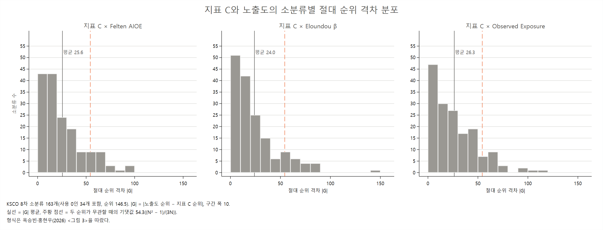

# AI 점유율 지표와 노출도의 순위 격차 엑셀 파일 설명

**9개 쌍(지표 A·B·C × Felten·Eloundou·Observed)의 격차 상위·하위 30**

AI-effects 프로젝트

> 이 문서는 같은 이름의 `.tex`와 같은 내용이다. 표 수치는 `results/table/36_*.tex`(code/04_19_analysis_kor_share_exposure_rankgap.do 생성)를 옮긴 것이다.

## 요약

이 노트는 `results/table/36_kor_share_exposure_rankgap.xlsx`를 설명한다. 파일은 `code/04_19_analysis_kor_share_exposure_rankgap.do`가 만든다. 점유율 지표 A·B·C(실제 사용)와 노출도 3개(Felten AIOE(Felten et al., 2023), Eloundou β(Eloundou et al., 2023), Observed Exposure(Massenkoff and McCrory, 2026))를 짝지은 9개 쌍마다, KSCO 8차 소분류 163개(사용 0인 34개 포함, 2026-11-01)의 순위 격차가 가장 큰 30개(사용 > 노출도)와 가장 작은 30개(사용 < 노출도)를 시트로 담았다.

- **순위 격차** G = r(노출도) − r(사용). 양수이면 사용 순위가 노출도 순위보다 높다. 순위는 paper 35와 같다.
- **시트 19개**: 쌍별 격차 상위 30 9개(`*_pos`), 하위 30 9개(`*_neg`), 163개 전부의 순위와 격차 9개(`all`).
- **격차는 크다.** 쌍마다 |G| 평균은 24~27계단이고, 30계단 이상 벌어진 소분류가 45~59개다. Eloundou 쌍이 조금 작다.
- **쌍을 바꿔도 같은 직업이 나온다.** 9개 쌍 모두의 상위 30에 드는 소분류가 10개, 하위 30에 드는 소분류가 10개다. 사용이 노출도보다 앞서는 쪽은 연구·공학·영상 전문가와 기능·설비 직업이고, 노출도가 앞서는 쪽은 보건(영양사, 약사, 간호사), 판매·상담, 사무 직업과 사용 0인 소분류(242 수의사, 297 식문화 관련 전문가)다.

## 1. 파일 구성

- **쌍별 시트**(18개): 이름은 `{사용 지표}_{노출도}_{pos|neg}`다. 사용 지표는 `A`, `B`, `C`, 노출도는 `FEL`(Felten AIOE), `ELO`(Eloundou β), `OE`(Observed Exposure)다. `pos`는 격차 상위 30(사용 > 노출도), `neg`는 격차 하위 30(사용 < 노출도)이다. 요청 목록 (8)~(16)이 `pos`, (17)~(25)가 `neg`다.
- **쌍별 시트의 열**: 격차 순위, KSCO 코드, 직업명, 사용 지표 값, 사용 지표 순위, 노출도 값, 노출도 순위, 순위 격차. 첫 열(격차 순위)은 요청 목록에 없던 열로, `pos`는 격차가 큰 순, `neg`는 격차가 작은(가장 음수인) 순이다.
- **참고 시트** `all`: 163개 소분류의 지표 A·B·C와 노출도 3개의 값·순위, 9개 쌍의 순위 격차. 30위 밖의 격차나 다른 기준으로 다시 고를 때 쓴다.

**정의.**

- 표본: 소분류 163개(paper 27·28·35와 같다). 한국 대화 비중이 두 달 모두 미공개인 34개는 사용 0(A = B = C = 0)이다.
- 순위 r(·): 163개 안에서 값이 큰 순서(1 = 가장 큼), 같은 값은 평균 순위(사용 0인 34개는 146.5위). 엑셀 35(paper 35)의 순위와 같다.
- 순위 격차 G_j(m, x) = r_j(x) − r_j(m). m은 사용 지표(A, B, C), x는 노출도다. G = +50이면 그 직업의 사용 순위가 노출도 순위보다 50계단 높다. 163개 안에서 Σ_j G_j = 0이다.
- 상위 30은 G 내림차순, 하위 30은 G 오름차순으로 고른다. G가 같으면 평균 순위를 주고, 30번째와 같은 G는 모두 넣는다(목록이 30개보다 길 수 있다).

지표와 노출도의 내용은 paper 35의 2절과 같다. 지표 A는 업무용 대화 점유율, B는 절감 시간 점유율, C는 B를 1인당 근로시간으로 나눈 취업자 환산 점유율이다.

## 2. 결과 개관

### 2.1 쌍별 요약

**표 1. 쌍별 순위 격차 요약(소분류 163개)**

| 사용 | 노출도 | ρ | G 절댓값 평균 | G 절댓값 ≥ 30 | G > 0 | 최대 | 최소 | 상위 30 경계 | 하위 30 경계 |
|---|---|---|---|---|---|---|---|---|---|
| 지표 A | Felten AIOE | 0.73 | 26.8 | 58 | 80 | +87.0 | -96.0 | +30.0 | -28.0 |
| 지표 A | Eloundou β | 0.74 | 24.4 | 45 | 89 | +92.0 | -141.5 | +24.0 | -23.0 |
| 지표 A | Observed Exposure | 0.73 | 25.9 | 54 | 83 | +112.5 | -104.5 | +29.5 | -28.0 |
| 지표 B | Felten AIOE | 0.75 | 25.8 | 53 | 85 | +84.0 | -95.0 | +27.0 | -27.0 |
| 지표 B | Eloundou β | 0.75 | 23.9 | 45 | 88 | +88.0 | -141.5 | +25.0 | -22.0 |
| 지표 B | Observed Exposure | 0.73 | 26.3 | 57 | 92 | +116.5 | -104.5 | +29.0 | -29.0 |
| 지표 C | Felten AIOE | 0.75 | 25.6 | 53 | 85 | +91.0 | -94.0 | +28.0 | -27.0 |
| 지표 C | Eloundou β | 0.75 | 24.0 | 45 | 87 | +86.0 | -141.5 | +24.0 | -21.0 |
| 지표 C | Observed Exposure | 0.73 | 26.3 | 59 | 92 | +114.5 | -104.5 | +31.0 | -29.0 |

ρ는 Spearman 순위상관, "경계"는 상위·하위 30번째 소분류의 격차다.

순위상관이 낮을수록 격차가 크다. Felten·Observed 쌍은 |G| 평균이 26~27계단, |G| ≥ 30인 소분류가 53~59개이고, Eloundou 쌍은 24계단 안팎, 45개다. 상위 30에 들려면 격차가 +24~+31계단, 하위 30에 들려면 −21~−29계단 이상이어야 한다. 격차가 양수인 소분류(80~92개)가 음수보다 많지만, 음수 쪽 최솟값(−94~−141.5)이 더 깊다. 사용 0인 소분류는 사용 순위가 146.5위라 노출도가 높으면 큰 음수 격차가 된다(Eloundou 쌍의 −141.5는 853 자동 조립라인 및 산업용로봇 조작원).

### 2.2 여러 쌍에서 반복되는 소분류

9개 쌍의 목록은 많이 겹친다. 상위 30 목록 9개를 합치면 서로 다른 소분류가 60개, 하위 30 목록은 55개뿐이다(표 4). 아래 표는 9개 중 7개 이상의 목록에 든 소분류다. 순위는 163개 안 순위이고, 평균 격차는 그 소분류가 든 목록들의 평균이다.

그림 1은 이 소분류들의 격차를 9개 쌍 모두에 대해 색으로 보여 준다. 위쪽(사용 > 노출도)은 거의 모든 칸이 파랑, 아래쪽(노출도 > 사용)은 거의 모든 칸이 빨강이다. 예외는 311 기획 및 마케팅 사무원의 A × Felten(−28)과 134 문화·예술 관련 관리자의 Observed 쌍(−18~−29)처럼 격차가 작은 칸이다.

**그림 1. 9개 쌍에서 반복되는 순위 격차(격차 목록 9개 중 7개 이상에 든 소분류)**

**표 2. 격차 상위 30(사용 > 노출도) 목록 9개 중 7개 이상에 든 소분류**

| 소분류 | 목록 수 | 평균 G | r(A) | r(C) | r(Felten) | r(Eloundou) | r(Observed) |
|---|---|---|---|---|---|---|---|
| 852 냉난방 관련 설비 조작원 | 9 | +88.8 | 37 | 35 | 101 | 121 | 149.5 |
| 799 기타 기능 관련 종사자 | 9 | +65.3 | 32 | 28 | 119 | 108 | 64 |
| 999 기타 서비스 관련 단순 종사자 | 9 | +61.0 | 52 | 76 | 133 | 144 | 116 |
| 910 건설 및 광업 단순 종사자 | 9 | +60.0 | 91 | 92 | 163 | 161 | 133 |
| 851 금속 공작 기계 조작원 | 9 | +56.0 | 97 | 86 | 149 | 151 | 134 |
| 782 건설 관련 기능 종사자 | 9 | +55.0 | 78 | 83 | 152 | 140 | 114 |
| 730 목재‧가구‧악기 및 간판 관련 기능 종사자 | 9 | +54.7 | 56 | 54 | 116 | 117 | 95 |
| 721 섬유 및 가죽 관련 기능 종사자 | 9 | +54.3 | 69 | 77 | 132 | 123 | 130 |
| 293 연극‧영화 및 영상 전문가 | 9 | +53.7 | 11 | 9 | 67 | 66 | 58 |
| 213 생명 및 자연과학 관련 시험원 | 9 | +51.3 | 8 | 7 | 84 | 53 | 40 |
| 149 기타 건설‧전기 및 생산 관련 관리자 | 8 | +57.9 | 46 | 34 | 81 | 69 | 126 |
| 941 청소 관련 종사자 | 8 | +46.6 | 99 | 80 | 142 | 131 | 122 |
| 235 기계‧로봇공학 기술자 및 시험원 | 8 | +44.3 | 15 | 17 | 56 | 41 | 78 |
| 239 기타 공학 전문가 및 관련 종사자 | 8 | +42.1 | 23 | 21 | 65 | 46 | 73 |
| 246 치료‧재활사 및 의료기사 | 7 | +44.9 | 38 | 47 | 71 | 84 | 99 |
| 264 문리‧기술 및 예능 강사 | 7 | +38.6 | 14 | 11 | 39 | 61 | 45 |

**표 3. 격차 하위 30(사용 < 노출도) 목록 9개 중 7개 이상에 든 소분류**

| 소분류 | 목록 수 | 평균 G | r(A) | r(C) | r(Felten) | r(Eloundou) | r(Observed) |
|---|---|---|---|---|---|---|---|
| 245 영양사 | 9 | -79.7 | 103 | 98 | 7 | 20 | 37 |
| 242 수의사 | 9 | -72.2 | 146.5 | 146.5 | 86 | 87 | 50 |
| 322 운송 및 무역 사무원 | 9 | -69.3 | 98 | 85 | 26 | 14 | 20 |
| 297 식문화 관련 전문가 | 9 | -67.2 | 146.5 | 146.5 | 88 | 67 | 83 |
| 531 통신 관련 판매 종사자 | 9 | -60.7 | 60 | 72 | 1 | 9 | 12 |
| 243 약사 및 한약사 | 9 | -55.7 | 104 | 111 | 50 | 56 | 52 |
| 311 기획 및 마케팅 사무원 | 9 | -54.7 | 63 | 84 | 35 | 2 | 27 |
| 159 기타 판매 및 고객 서비스 관리자 | 9 | -44.7 | 86 | 71 | 30 | 28 | 33 |
| 244 간호사 | 9 | -39.3 | 106 | 108 | 70 | 70 | 63 |
| 312 인사 및 교육·훈련 사무원 | 9 | -34.7 | 43 | 46 | 8 | 16 | 7 |
| 362 고객 상담 및 모니터 요원 | 8 | -42.1 | 44 | 53 | 18 | 7 | 4 |
| 134 문화‧예술 관련 관리자 | 7 | -42.3 | 89 | 79 | 41 | 34 | 60 |
| 238 항공기‧선박 기관사 및 관제사 | 7 | -34.6 | 118 | 113 | 83 | 75 | 90 |

**사용이 노출도보다 앞서는 직업.** 주로 두 묶음이다.

- **연구·공학·영상·의료 전문가와 관리자**(213, 293, 235, 239, 264, 246, 149). 사용 순위는 7~47위로 높은데 노출도 순위는 39~126위다. 노출도가 중간인 직업에서 실제 대화가 많이 나온 경우다.
- **기능·설비·단순 직업**(852, 799, 730, 721, 782, 851, 910, 999, 941). 노출도는 대부분 100위 밖으로 낮은데(Observed는 64~149.5위) 사용은 28~99위의 중하위권이다. 노출도 순위가 바닥이라 사용이 조금만 있어도 격차가 크게 나온다. 852 냉난방 관련 설비 조작원은 Observed Exposure가 0이라 그 순위(149.5위)는 값이 0인 28개의 평균 순위다.

**노출도가 사용보다 앞서는 직업.** 세 묶음이다.

- **보건**(245 영양사, 243 약사 및 한약사, 244 간호사). 노출도 순위는 7~70위인데 사용 순위는 98~111위다. 245 영양사는 Felten 7위, 지표 A 103위로 평균 격차가 −80이다.
- **판매·상담·관리**(531 통신 관련 판매, 159 기타 판매 및 고객 서비스 관리자, 362 고객 상담 및 모니터 요원, 134 문화·예술 관련 관리자). Felten에서 특히 높다(531은 Felten 1위).
- **사무**(322 운송 및 무역 사무원, 311 기획 및 마케팅 사무원, 312 인사 및 교육·훈련 사무원). 세 노출도 모두 2~35위로 높지만 사용 순위는 43~98위다. paper 29에서 "노출도 > 사용"으로 나온 311이 여기에도 든다. 129개만 보던 이전 판에서 7개 이상이었던 331 회계 및 경리 사무원과 532 방문 및 노점 판매 종사자, 429 기타 돌봄 및 보건 서비스 종사자는 빠졌다.

### 2.3 대표 쌍: 지표 C × Eloundou β

그림 2는 지표 C와 Eloundou β 쌍의 시트 `C_ELO_pos`, `C_ELO_neg`를 그린 것이다. 직업마다 파란 점은 지표 C 순위, 주황 점은 Eloundou β 순위이고, 둘 사이 선의 길이가 격차다. 사용 > 노출도 쪽에서는 852 냉난방 관련 설비 조작원(+86)과 799 기타 기능 관련 종사자(+80)처럼 노출도가 바닥권인 직업이 위에 오고, 노출도 > 사용 쪽에서는 853 자동 조립라인 및 산업용로봇 조작원(−141.5), 232 화학공학 기술자 및 시험원(−84.5), 311 기획 및 마케팅 사무원(−82)처럼 노출도가 높은데 사용이 0이거나 적은 직업이 위에 온다. 하위 목록 30개 중 8개가 사용 0인 소분류(오른쪽 칸에서 파란 점이 146.5위에 몰린 것)다. 선이 그래프의 어느 쪽에 있는지를 보면 격차가 순위 분포의 어디에서 생겼는지 알 수 있다.

**그림 2. 지표 C와 Eloundou β의 순위 격차 상위 30·하위 30(괄호 = 격차 G)**

### 2.4 격차 전체의 분포: 지표 C × 노출도 3개

그림 3은 옥승빈·홍현우(2026)의 〈그림 3〉(LM Index와 OECD Index의 직업별 절대 순위 차이 분포)과 같은 형식으로, 지표 C와 노출도 3개의 절대 순위 격차 |G|를 163개 소분류 전부에 대해 그린 것이다. 구간 폭은 10이고, 실선은 |G| 평균이다. 두 순위가 서로 무관할 때 |G|의 기댓값 (N² − 1)/(3N) = 54.3(N = 163, 동점 없음)을 주황 점선으로 더했다.

- **분포는 0 쪽에 몰려 있다.** |G| < 20인 소분류가 Felten 86개, Eloundou 93개, Observed 77개로 절반 안팎이고, 평균은 25.6, 24.0, 26.3계단이다(표 1과 같은 값). |G| ≥ 50인 소분류는 23~25개다.
- **긴 오른쪽 꼬리는 소수 직업이다.** 100계단이 넘는 격차는 Eloundou 1개(853, |G| = 141.5)와 Observed 2개뿐이고, Felten은 최대 94다. 이 꼬리가 2.2·2.3절의 목록에 든다.
- **옥승빈·홍현우(2026)와 비교.** 같은 163개 소분류에서 그 논문의 LM Index와 OECD Index의 평균 절대 순위 차이는 67.7위로, 무관할 때의 기댓값 54.3보다도 크다(두 지수의 Spearman 상관이 −0.446). 지표 C와 노출도 3개의 평균 격차(24~26)는 그 3분의 1 남짓이다. 실제 사용 순위와 노출도 순위의 차이가 서로 다른 노출도 지수끼리의 차이보다 훨씬 작다. 다만 그 논문은 같은 값에 가장 작은 순위를 함께 주고, 이 노트는 평균 순위를 주므로(사용 0인 34개는 146.5위) 수치를 엄밀히 맞댄 것은 아니다.

**그림 3. 지표 C와 노출도 3개의 소분류별 절대 순위 격차 분포(옥승빈·홍현우(2026) 〈그림 3〉 형식)**

## 3. 읽을 때 유의사항

**표 4. 점검 수치**

| 항목 | 값 |
|---|---|
| 비교 소분류 수 / 그중 사용 0(지표 A·B·C = 0) | 163 / 34 |
| 목록 칸 수: 상위 30 목록 / 하위 30 목록(9개 쌍 합, 경계 동점 포함) | 277 / 272 |
| 사용 0인 소분류가 든 칸: 상위 30 목록 / 하위 30 목록 | 0 / 78 |
| 9개 쌍 상위 30 목록에 한 번 이상 든 소분류 수 / 9개 모두에 든 수 | 60 / 10 |
| 9개 쌍 하위 30 목록에 한 번 이상 든 소분류 수 / 9개 모두에 든 수 | 55 / 10 |
| Observed Exposure = 0인 소분류 수 | 28 |
| Observed Exposure 쌍 상위 30(3개 목록) 중 Observed Exposure = 0인 칸 | 23 / 93 |
| 한 달만 공개된 소분류 수 | 7 |
| 한 달만 공개된 소분류가 든 칸: 상위 30 목록 / 하위 30 목록 | 6 / 3 |

1. **순위 격차는 분포의 끝에서 작아진다.** 사용 1위 직업은 양의 격차를 가질 수 없고, 맨 아래 순위의 직업은 음의 격차를 가질 수 없다. 그래서 사용 최상위 직업(222, 291 등)은 노출도도 높아 목록에 잘 들지 않고, 목록은 중간 순위 직업 위주가 된다. 강도 자체(몇 배 차이인지)는 paper 29의 로그 비율 격차로 본다.
2. **Observed Exposure가 0인 소분류 28개는 동점이다.** 사용이 있는 13개와 사용 0인 15개가 모두 149.5위(평균 순위)다. Observed 쌍 상위 30 목록(3개, 93칸) 중 23칸이 이 소분류다.
3. **사용 0인 34개는 하위 30 목록에 많이 든다.** 사용 순위가 146.5위로 동점이라 노출도가 중간 이상이면 큰 음수 격차가 된다. 9개 쌍 하위 30 목록 272칸 중 78칸이 사용 0인 소분류다. 이들의 0은 실제 사용이 없다는 뜻이라기보다 연결된 SOC의 한국 비중이 공개되지 않았다는 뜻이다. 한 달만 공개된 소분류 7개(비공개 달을 0으로 두어 값이 절반, paper 27)는 상위 목록 6칸, 하위 목록 3칸에 든다.
4. **점유율은 직업 규모가 들어간 값이다.** 큰 직업은 점유율 순위가 오르기 쉬워 격차가 양수 쪽으로 간다. 규모를 뺀 비교는 상대 활용도(paper 25, 32)나 노출도 기반 점유율(paper 28, 33)로 본다.
5. **두 쪽 모두 SOC 값을 연계표로 옮긴 것이다**(paper 21, 23). 한 SOC에 쏠린 소분류는 그 SOC의 값에 따라 격차가 크게 움직인다. 격차가 큰 직업은 SOC 구성(paper 26)을 함께 확인하는 것이 좋다.

## 4. 산출 파일

- 코드: `code/04_19_analysis_kor_share_exposure_rankgap.do`(Stata 17, `00_master.do`에 포함). 입력은 `data/proc/merged/kor_ai_usage_ksco3.dta`(`03_05`).
- 엑셀: `results/table/36_kor_share_exposure_rankgap.xlsx`(시트 19개).
- 이 노트의 표: `results/table/36_summary.tex`, `36_robust_pos.tex`, `36_robust_neg.tex`, `36_notes.tex`.
- 그림: `results/figure/36_fig_heatmap_robust.{pdf,png}`, `36_fig_dumbbell_C_ELO.{pdf,png}`, `36_fig_absgap_hist_C.{pdf,png}`(`code/04_20_analysis_kor_share_figures.do`).

## 참고문헌

- Eloundou, T., Manning, S., Mishkin, P., and Rock, D. (2023). GPTs are GPTs: An early look at the labor market impact potential of large language models.
- Felten, E., Raj, M., and Seamans, R. (2023). How will language modelers like ChatGPT affect occupations and industries?
- Massenkoff, M., and McCrory, P. (2026). Labor market impacts of AI: A new measure and early evidence.
- 옥승빈, 홍현우 (2026). 한국 노동시장의 AI 노출 지형은 측정방식에 따라 달라지는가?: OECD와 Felten 기반 직업 및 산업 노출도 지수의 비교. 『한국경제포럼』 19(3), 11–47.
