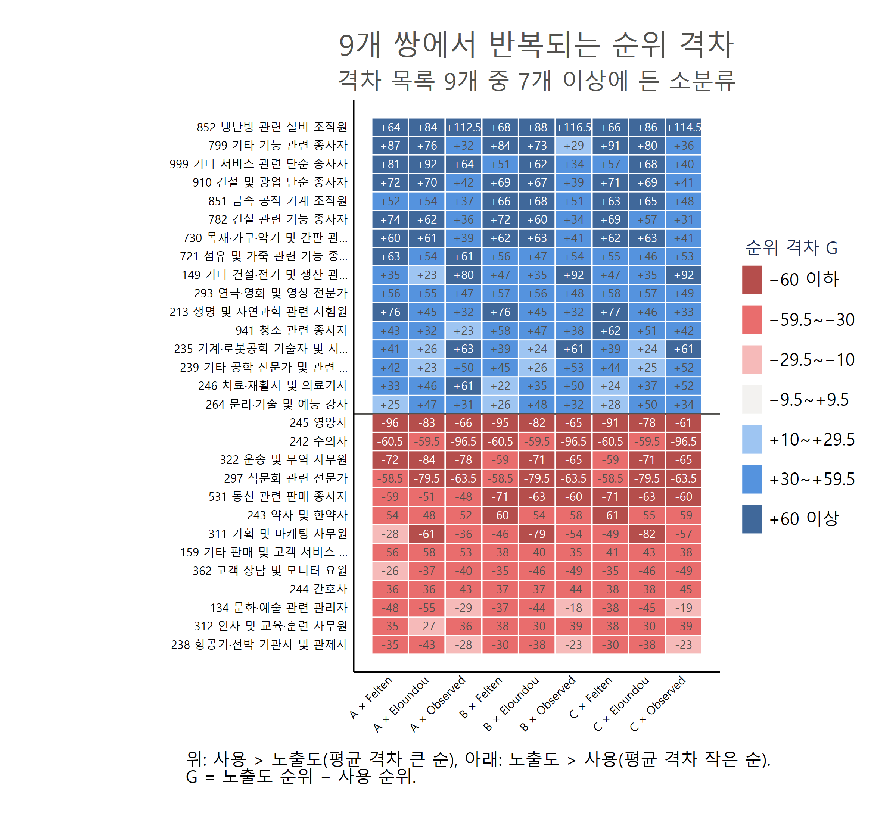
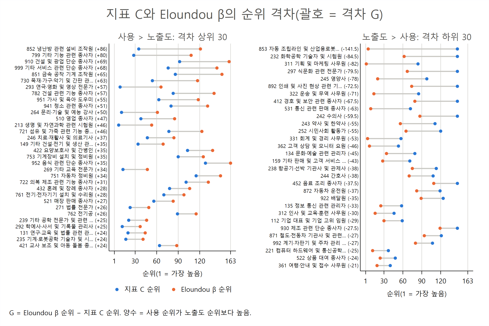

# AI 점유율 지표와 노출도의 순위 격차 엑셀 파일 설명

**9개 쌍(지표 A·B·C × Felten·Eloundou·Observed)의 격차 상위·하위 30**

AI-effects 프로젝트

> 이 문서는 같은 이름의 `.tex`와 같은 내용이다. 표 수치는 `results/table/36_*.tex`(code/04_19_analysis_kor_share_exposure_rankgap.do 생성)를 옮긴 것이다.

## 요약

이 노트는 `results/table/36_kor_share_exposure_rankgap.xlsx`를 설명한다. 파일은 `code/04_19_analysis_kor_share_exposure_rankgap.do`가 만든다. 점유율 지표 A·B·C(실제 사용)와 노출도 3개(Felten AIOE(Felten et al., 2023), Eloundou β(Eloundou et al., 2023), Observed Exposure(Massenkoff and McCrory, 2026))를 짝지은 9개 쌍마다, KSCO 8차 소분류 129개의 순위 격차가 가장 큰 30개(사용 > 노출도)와 가장 작은 30개(사용 < 노출도)를 시트로 담았다.

- **순위 격차** G = r(노출도) − r(사용). 양수이면 사용 순위가 노출도 순위보다 높다. 순위는 paper 35와 같다.
- **시트 19개**: 쌍별 격차 상위 30 9개(`*_pos`), 하위 30 9개(`*_neg`), 129개 전부의 순위와 격차 9개(`all`).
- **격차는 크다.** 쌍마다 |G| 평균은 22~27계단이고, 30계단 이상 벌어진 소분류가 33~48개다. Felten과의 격차가 가장 크다.
- **쌍을 바꿔도 같은 직업이 나온다.** 9개 쌍 모두의 상위 30에 드는 소분류가 11개, 하위 30에 드는 소분류가 13개다. 사용이 노출도보다 앞서는 쪽은 연구·공학·영상 전문가와 기능·설비 직업이고, 노출도가 앞서는 쪽은 보건(영양사, 약사, 간호사), 판매·상담, 사무 직업이다.

## 1. 파일 구성

- **쌍별 시트**(18개): 이름은 `{사용 지표}_{노출도}_{pos|neg}`다. 사용 지표는 `A`, `B`, `C`, 노출도는 `FEL`(Felten AIOE), `ELO`(Eloundou β), `OE`(Observed Exposure)다. `pos`는 격차 상위 30(사용 > 노출도), `neg`는 격차 하위 30(사용 < 노출도)이다. 요청 목록 (8)~(16)이 `pos`, (17)~(25)가 `neg`다.
- **쌍별 시트의 열**: 격차 순위, KSCO 코드, 직업명, 사용 지표 값, 사용 지표 순위, 노출도 값, 노출도 순위, 순위 격차. 첫 열(격차 순위)은 요청 목록에 없던 열로, `pos`는 격차가 큰 순, `neg`는 격차가 작은(가장 음수인) 순이다.
- **참고 시트** `all`: 129개 소분류의 지표 A·B·C와 노출도 3개의 값·순위, 9개 쌍의 순위 격차. 30위 밖의 격차나 다른 기준으로 다시 고를 때 쓴다.

**정의.**

- 표본: 지표 A·B·C와 노출도 3개가 모두 있는 소분류 129개(paper 27·28·35와 같다).
- 순위 r(·): 129개 안에서 값이 큰 순서(1 = 가장 큼), 같은 값은 소분류 코드 순. 엑셀 35(paper 35)의 순위와 같다.
- 순위 격차 G_j(m, x) = r_j(x) − r_j(m). m은 사용 지표(A, B, C), x는 노출도다. G = +50이면 그 직업의 사용 순위가 노출도 순위보다 50계단 높다. 129개 안에서 Σ_j G_j = 0이다.
- 상위 30은 G 내림차순, 하위 30은 G 오름차순으로 고른다. G가 같으면 코드 순이다.

지표와 노출도의 내용은 paper 35의 2절과 같다. 지표 A는 업무용 대화 점유율, B는 절감 시간 점유율, C는 B를 1인당 근로시간으로 나눈 취업자 환산 점유율이다.

## 2. 결과 개관

### 2.1 쌍별 요약

**표 1. 쌍별 순위 격차 요약(소분류 129개)**

| 사용 | 노출도 | ρ | G 절댓값 평균 | G 절댓값 ≥ 30 | G > 0 | 최대 | 최소 | 상위 30 경계 | 하위 30 경계 |
|---|---|---|---|---|---|---|---|---|---|
| 지표 A | Felten AIOE | 0.60 | 26.5 | 48 | 64 | +80 | -96 | +26 | -23 |
| 지표 A | Eloundou β | 0.69 | 22.4 | 33 | 68 | +76 | -85 | +19 | -20 |
| 지표 A | Observed Exposure | 0.70 | 22.2 | 38 | 64 | +88 | -78 | +20 | -19 |
| 지표 B | Felten AIOE | 0.63 | 25.4 | 45 | 65 | +77 | -95 | +25 | -22 |
| 지표 B | Eloundou β | 0.70 | 22.0 | 35 | 66 | +80 | -83 | +21 | -18 |
| 지표 B | Observed Exposure | 0.69 | 22.4 | 39 | 70 | +92 | -72 | +20 | -20 |
| 지표 C | Felten AIOE | 0.63 | 25.3 | 43 | 65 | +84 | -94 | +25 | -21 |
| 지표 C | Eloundou β | 0.70 | 22.2 | 36 | 68 | +78 | -82 | +19 | -18 |
| 지표 C | Observed Exposure | 0.69 | 22.5 | 39 | 68 | +90 | -73 | +21 | -20 |

ρ는 Spearman 순위상관, "경계"는 상위·하위 30번째 소분류의 격차다.

순위상관이 낮을수록 격차가 크다. Felten 쌍은 |G| 평균이 25~27계단, |G| ≥ 30인 소분류가 43~48개로 가장 크고, Eloundou·Observed 쌍은 22계단 안팎이다. 상위 30에 들려면 격차가 +19~+26계단, 하위 30에 들려면 −18~−23계단 이상이어야 한다. 격차가 양수인 소분류(64~70개)가 음수보다 조금 많지만, 음수 쪽 최솟값(−72~−96)이 더 깊은 쌍이 많다.

### 2.2 여러 쌍에서 반복되는 소분류

9개 쌍의 목록은 많이 겹친다. 상위 30 목록 9개를 합치면 서로 다른 소분류가 56개, 하위 30 목록은 52개뿐이다(표 4). 아래 표는 9개 중 7개 이상의 목록에 든 소분류다. 순위는 129개 안 순위이고, 평균 격차는 그 소분류가 든 목록들의 평균이다.

그림 1은 이 소분류들의 격차를 9개 쌍 모두에 대해 색으로 보여 준다. 위쪽(사용 > 노출도)은 거의 모든 칸이 파랑, 아래쪽(노출도 > 사용)은 거의 모든 칸이 빨강이다. 예외는 532 방문 및 노점 판매 종사자로, Felten 쌍에서는 −71~−94이지만 Eloundou 쌍에서는 +4~−19로 격차가 거의 없다.

**그림 1. 9개 쌍에서 반복되는 순위 격차(격차 목록 9개 중 7개 이상에 든 소분류)**

**표 2. 격차 상위 30(사용 > 노출도) 목록 9개 중 7개 이상에 든 소분류**

| 소분류 | 목록 수 | 평균 G | r(A) | r(C) | r(Felten) | r(Eloundou) | r(Observed) |
|---|---|---|---|---|---|---|---|
| 852 냉난방 관련 설비 조작원 | 9 | +76.3 | 37 | 35 | 96 | 113 | 125 |
| 799 기타 기능 관련 종사자 | 9 | +60.3 | 32 | 28 | 112 | 102 | 62 |
| 293 연극‧영화 및 영상 전문가 | 9 | +52.0 | 11 | 9 | 66 | 64 | 56 |
| 213 생명 및 자연과학 관련 시험원 | 9 | +50.7 | 8 | 7 | 83 | 52 | 40 |
| 149 기타 건설‧전기 및 생산 관련 관리자 | 9 | +47.7 | 46 | 34 | 80 | 66 | 111 |
| 730 목재‧가구‧악기 및 간판 관련 기능 종사자 | 9 | +47.7 | 56 | 54 | 109 | 110 | 88 |
| 999 기타 서비스 관련 단순 종사자 | 9 | +47.0 | 52 | 76 | 120 | 125 | 106 |
| 721 섬유 및 가죽 관련 기능 종사자 | 9 | +41.7 | 69 | 77 | 119 | 115 | 113 |
| 235 기계‧로봇공학 기술자 및 시험원 | 9 | +40.3 | 15 | 17 | 56 | 40 | 74 |
| 239 기타 공학 전문가 및 관련 종사자 | 9 | +38.3 | 23 | 21 | 64 | 45 | 70 |
| 211 생명 및 자연과학 관련 전문가 | 9 | +30.3 | 12 | 10 | 43 | 31 | 48 |
| 782 건설 관련 기능 종사자 | 8 | +40.1 | 78 | 83 | 128 | 123 | 104 |
| 851 금속 공작 기계 조작원 | 8 | +36.4 | 97 | 86 | 127 | 127 | 115 |
| 264 문리‧기술 및 예능 강사 | 8 | +36.3 | 14 | 11 | 39 | 60 | 44 |
| 910 건설 및 광업 단순 종사자 | 8 | +32.8 | 91 | 92 | 129 | 128 | 114 |
| 246 치료‧재활사 및 의료기사 | 7 | +39.6 | 38 | 47 | 70 | 79 | 92 |
| 236 소방‧방재‧산업안전 기술자 및 시험원 | 7 | +32.9 | 33 | 30 | 58 | 51 | 75 |
| 941 청소 관련 종사자 | 7 | +32.9 | 99 | 80 | 123 | 119 | 109 |

**표 3. 격차 하위 30(사용 < 노출도) 목록 9개 중 7개 이상에 든 소분류**

| 소분류 | 목록 수 | 평균 G | r(A) | r(C) | r(Felten) | r(Eloundou) | r(Observed) |
|---|---|---|---|---|---|---|---|
| 245 영양사 | 9 | -80.0 | 103 | 98 | 7 | 19 | 37 |
| 322 운송 및 무역 사무원 | 9 | -69.7 | 98 | 85 | 26 | 13 | 20 |
| 531 통신 관련 판매 종사자 | 9 | -61.0 | 60 | 72 | 1 | 8 | 12 |
| 243 약사 및 한약사 | 9 | -56.7 | 104 | 111 | 50 | 55 | 50 |
| 311 기획 및 마케팅 사무원 | 9 | -54.7 | 63 | 84 | 35 | 2 | 27 |
| 159 기타 판매 및 고객 서비스 관리자 | 9 | -45.0 | 86 | 71 | 30 | 27 | 33 |
| 244 간호사 | 9 | -41.3 | 106 | 108 | 69 | 67 | 61 |
| 362 고객 상담 및 모니터 요원 | 9 | -40.7 | 44 | 53 | 18 | 6 | 4 |
| 134 문화‧예술 관련 관리자 | 9 | -38.0 | 89 | 79 | 41 | 33 | 58 |
| 238 항공기‧선박 기관사 및 관제사 | 9 | -36.0 | 118 | 113 | 82 | 71 | 83 |
| 312 인사 및 교육·훈련 사무원 | 9 | -35.0 | 43 | 46 | 8 | 15 | 7 |
| 451 조리사 | 9 | -29.3 | 129 | 129 | 95 | 106 | 98 |
| 429 기타 돌봄 및 보건 서비스 종사자 | 9 | -26.7 | 119 | 116 | 87 | 95 | 91 |
| 331 회계 및 경리 사무원 | 8 | -38.6 | 45 | 57 | 33 | 4 | 17 |
| 532 방문 및 노점 판매 종사자 | 7 | -67.4 | 81 | 104 | 10 | 85 | 31 |
| 441 운송 서비스 종사자 | 7 | -41.3 | 101 | 112 | 84 | 89 | 46 |
| 423 노인 및 장애인 돌봄 종사자 | 7 | -34.7 | 115 | 110 | 81 | 94 | 69 |
| 112 기업 대표 및 기업 고위 임원 | 7 | -31.0 | 72 | 59 | 31 | 29 | 53 |

**사용이 노출도보다 앞서는 직업.** 주로 두 묶음이다.

- **연구·공학·영상 전문가**(213, 211, 293, 235, 239, 264). 사용 순위는 7~23위로 높은데 노출도 순위는 31~83위다. 노출도가 중간인 직업에서 실제 대화가 많이 나온 경우다.
- **기능·설비·단순 직업**(852, 799, 730, 721, 782, 851, 910, 999, 941). 노출도는 대부분 100위 밖으로 낮은데(Observed는 62~125위) 사용은 28~99위의 중하위권이다. 노출도 순위가 바닥이라 사용이 조금만 있어도 격차가 크게 나온다. 852 냉난방 관련 설비 조작원은 Observed Exposure가 0이라 그 순위(125위)가 동점 처리의 결과다.

**노출도가 사용보다 앞서는 직업.** 세 묶음이다.

- **보건**(245 영양사, 243 약사 및 한약사, 244 간호사, 429 기타 돌봄 및 보건 서비스). 노출도 순위는 7~95위인데 사용 순위는 98~119위다. 245 영양사는 Felten 7위, 지표 A 103위로 평균 격차가 −80이다.
- **판매·상담·관리**(531 통신 관련 판매, 159 기타 판매 및 고객 서비스 관리자, 362 고객 상담 및 모니터 요원, 532 방문 및 노점 판매, 134 문화·예술 관련 관리자). Felten에서 특히 높다(531은 Felten 1위).
- **사무**(322 운송 및 무역 사무원, 311 기획 및 마케팅 사무원, 312 인사 및 교육·훈련 사무원, 331 회계 및 경리 사무원). 세 노출도 모두 2~35위로 높지만 사용 순위는 43~98위다. paper 29에서 "노출도 > 사용"으로 나온 311과 331이 여기에도 든다.

### 2.3 대표 쌍: 지표 C × Eloundou β

그림 2는 지표 C와 Eloundou β 쌍의 시트 `C_ELO_pos`, `C_ELO_neg`를 그린 것이다. 직업마다 파란 점은 지표 C 순위, 주황 점은 Eloundou β 순위이고, 둘 사이 선의 길이가 격차다. 사용 > 노출도 쪽에서는 852 냉난방 관련 설비 조작원(+78)과 799 기타 기능 관련 종사자(+74)처럼 노출도가 바닥권인 직업이 위에 오고, 노출도 > 사용 쪽에서는 311 기획 및 마케팅 사무원(−82), 245 영양사(−79), 322 운송 및 무역 사무원(−72)처럼 노출도가 최상위권인 직업이 위에 온다. 선이 그래프의 어느 쪽에 있는지를 보면 격차가 순위 분포의 어디에서 생겼는지 알 수 있다.

**그림 2. 지표 C와 Eloundou β의 순위 격차 상위 30·하위 30(괄호 = 격차 G)**

## 3. 읽을 때 유의사항

**표 4. 점검 수치**

| 항목 | 값 |
|---|---|
| 비교 소분류 수 | 129 |
| 9개 쌍 상위 30 목록에 한 번 이상 든 소분류 수 / 9개 모두에 든 수 | 56 / 11 |
| 9개 쌍 하위 30 목록에 한 번 이상 든 소분류 수 / 9개 모두에 든 수 | 52 / 13 |
| Observed Exposure = 0인 소분류 수 | 13 |
| Observed Exposure 쌍 상위 30(3개 목록, 90칸) 중 Observed Exposure = 0인 칸 | 12 / 90 |
| 한 달만 공개된 소분류 수 | 7 |
| 한 달만 공개된 소분류가 든 칸: 상위 30 목록 / 하위 30 목록(각 270칸) | 0 / 14 |

1. **순위 격차는 분포의 끝에서 작아진다.** 사용 1위 직업은 양의 격차를 가질 수 없고, 129위 직업은 음의 격차를 가질 수 없다. 그래서 사용 최상위 직업(222, 291 등)은 노출도도 높아 목록에 잘 들지 않고, 목록은 중간 순위 직업 위주가 된다. 강도 자체(몇 배 차이인지)는 paper 29의 로그 비율 격차로 본다.
2. **Observed Exposure가 0인 소분류 13개는 117~129위 동점이다.** 코드 순으로 순위를 매겼기 때문에 이 소분류의 Observed 쌍 격차는 최대 12계단까지 코드 순서에 따라 달라진다. Observed 쌍 상위 30 목록 90칸 중 12칸이 이 소분류다(852, 710, 881, 882, 422, 453).
3. **한 달만 공개된 소분류는 하위 30 쪽에만 든다.** 7개 중 사용 순위가 바닥인 소분류(451 조리사 등)가 하위 30 목록 14칸에 든다. 비공개 달을 0으로 두어 사용 값이 절반이 된 영향이 섞여 있다(paper 27).
4. **점유율은 직업 규모가 들어간 값이다.** 큰 직업은 점유율 순위가 오르기 쉬워 격차가 양수 쪽으로 간다. 규모를 뺀 비교는 상대 활용도(paper 25, 32)나 노출도 기반 점유율(paper 28, 33)로 본다.
5. **두 쪽 모두 SOC 값을 연계표로 옮긴 것이다**(paper 21, 23). 한 SOC에 쏠린 소분류는 그 SOC의 값에 따라 격차가 크게 움직인다. 격차가 큰 직업은 SOC 구성(paper 26)을 함께 확인하는 것이 좋다.

## 4. 산출 파일

- 코드: `code/04_19_analysis_kor_share_exposure_rankgap.do`(Stata 17, `00_master.do`에 포함). 입력은 `data/proc/merged/kor_ai_usage_ksco3.dta`(`03_05`).
- 엑셀: `results/table/36_kor_share_exposure_rankgap.xlsx`(시트 19개).
- 이 노트의 표: `results/table/36_summary.tex`, `36_robust_pos.tex`, `36_robust_neg.tex`, `36_notes.tex`.
- 그림: `results/figure/36_fig_heatmap_robust.{pdf,png}`, `36_fig_dumbbell_C_ELO.{pdf,png}`(`code/04_20_analysis_kor_share_figures.do`).

## 참고문헌

- Eloundou, T., Manning, S., Mishkin, P., and Rock, D. (2023). GPTs are GPTs: An early look at the labor market impact potential of large language models.
- Felten, E., Raj, M., and Seamans, R. (2023). How will language modelers like ChatGPT affect occupations and industries?
- Massenkoff, M., and McCrory, P. (2026). Labor market impacts of AI: A new measure and early evidence.
