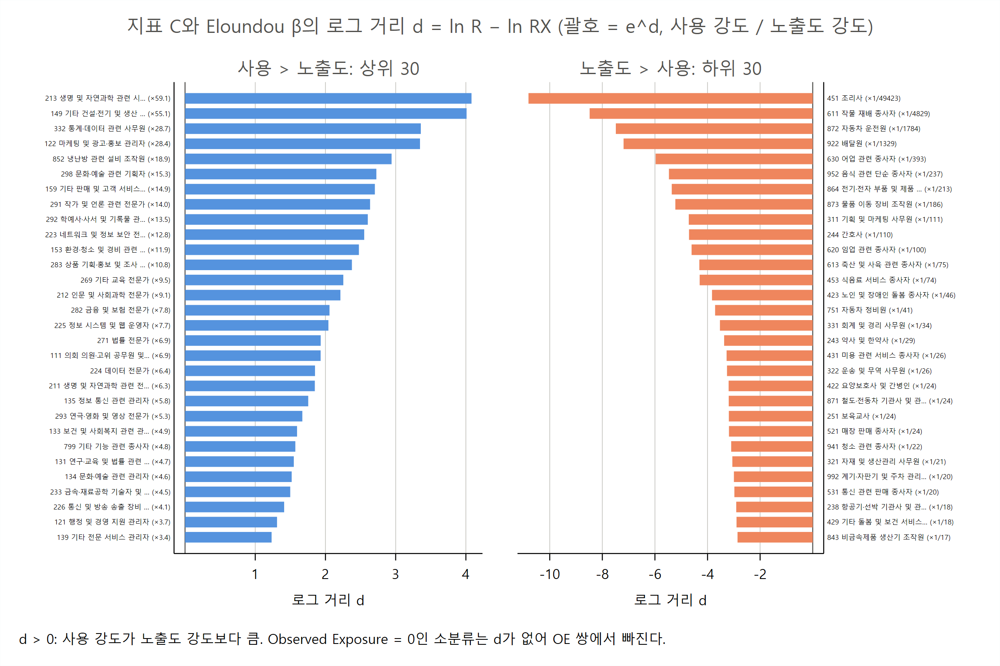
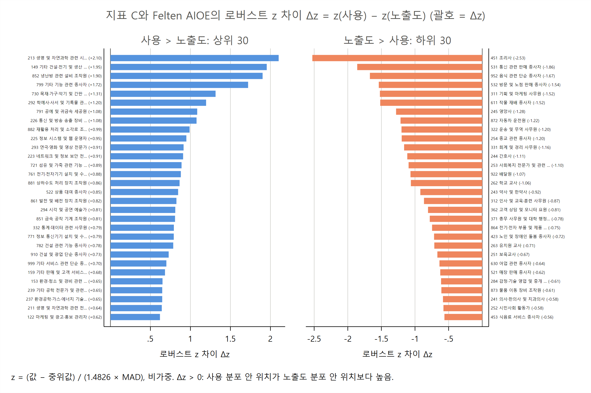
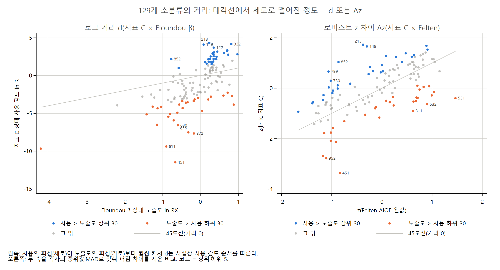

# AI 점유율 지표와 노출도: 순위 격차 외 지표 엑셀 파일 설명

**누적 점유율, 집중지수·HHI, 탄력성, 로그 거리, 로버스트 z**

AI-effects 프로젝트

> 이 문서는 같은 이름의 `.tex`와 같은 내용이다. 표 수치는 `results/table/37_*.tex`(code/04_21_analysis_kor_share_exposure_metrics.do 생성)를 옮긴 것이다.

## 요약

이 노트는 `results/table/37_kor_share_exposure_metrics.xlsx`를 설명한다. 파일은 `code/04_21_analysis_kor_share_exposure_metrics.do`가 만든다. 순위 격차(paper 35·36)는 값의 크기와 쏠림을 담지 못하므로, 점유율 지표 A·B·C와 노출도 3개(Felten AIOE(Felten et al., 2023), Eloundou β(Eloundou et al., 2023), Observed Exposure(Massenkoff and McCrory, 2026))를 값 자체로 비교하는 지표 다섯 가지를 KSCO 8차 소분류 129개에서 계산했다. 정의는 paper 33과 같고 값도 같다. 이 파일은 그 지표를 직업 목록과 함께 한곳에 정리한 것이다.

- **누적 점유율**: 사용은 상위 10개 소분류가 55%, 상위 30개가 81~84%를 차지한다. 취업자 비중(38%, 68%)보다 훨씬 쏠려 있다. 노출도 순으로 줄 세우면 Observed Exposure 상위 10개가 사용의 43%를, Felten 상위 10개는 7~8%만 가진다.
- **집중도**: 노출도 순 집중지수는 0.52~0.63으로 사용이 노출도 높은 직업에 몰려 있다. Observed Exposure로 만든 노출도 기반 점유율(0.60)과는 비슷하고 Eloundou β(0.34)보다는 크다. 실효 직업 수(1/HHI)는 사용 22개로, 취업자(43개)의 절반이다.
- **탄력성**: 사용 강도의 Observed Exposure 탄력성은 1.00~1.07(비례), Eloundou β 탄력성은 1.80~2.21이다. β의 차이가 사용에서 두 배 가까이 증폭된다.
- **로그 거리와 로버스트 z**: 지표 C와 Eloundou β의 로그 거리는 절댓값 평균 2.22(약 9배 차이)다. 퍼짐을 맞춘 로버스트 z 차이는 절댓값 평균 0.63~0.75다. 두 거리 모두에서 213 생명 및 자연과학 관련 시험원이 "사용 > 노출도" 1위, 451 조리사가 "노출도 > 사용" 1위다.

## 1. 파일 구성

**표 1. 시트 구성(요청 목록 번호)**

| 시트 | 내용 | 열과 행 |
|---|---|---|
| `topshare` | (1) 누적 점유율 | 분포, 정렬 기준, 상위 10·20·30개 합(%). 위 6행은 각 분포를 자기 값 순으로 줄 세운 것(지표 A·B·C, 노출도 기반 점유율 2개, 참고로 취업자 비중). 아래 12행은 노출도 순으로 줄 세웠을 때 노출도 상위 k개 소분류가 가진 사용 점유율(Felten 포함). |
| `conc` | (2) 집중도 | 왼쪽: 집중지수(사용 지표 × 노출도 9개, 노출도 기반 점유율 2개). 오른쪽(E열부터): HHI와 실효 직업 수. |
| `elas` | (3) 탄력성 | 사용 지표 × 노출도 9행. β(취업자 가중 OLS)와 robust SE, 95% 구간, R², 소분류 수, 비가중 OLS, 분위수 회귀 τ = 0.1, 0.5, 0.9. Felten 행은 준탄력성. |
| `d_all` | (4) 로그 거리 | 129개 소분류의 취업자 수, 취업자 비중 w, 점유율 s, 노출도 기반 점유율 XS, 상대 강도 R, RX, 로그 거리 d 6개. |
| `d_top30` | (4) 로그 거리 상위 30 | 쌍(6개) × 방향(사용 > 노출도, 노출도 > 사용) × 30행. 열: 사용 지표, 노출도, 방향, 순위, 코드, 직업명, d, e^d, R, RX, 취업자 수. |
| `z_all` | (5) 로버스트 z | 129개 소분류의 노출도 원값 3개, 로버스트 z 6개, Δz 9개. |
| `z_top30` | (5) z 차이 상위 30 | 쌍(9개) × 방향 × 30행. 열: 사용 지표, 노출도, 방향, 순위, 코드, 직업명, Δz, z(사용), z(노출도), 취업자 수. |

- **"큰 상위 30개"의 뜻**: 로그 거리와 z 차이는 부호가 있다. 절댓값으로 30개를 고르면 두 방향이 섞이므로, 쌍마다 양수 쪽 30개(사용 > 노출도)와 음수 쪽 30개(노출도 > 사용)를 따로 실었다(작업자 판단).
- **Felten**: 음수가 있어 노출도 기반 점유율, 상대 강도, 로그 거리, 탄력성을 만들 수 없다. 순서만 쓰는 누적 점유율(노출도 순)·집중지수와 원값으로 만든 로버스트 z에는 넣었고, 탄력성 시트에는 원값에 회귀한 준탄력성을 참고로 실었다.
- **Observed Exposure = 0인 소분류 13개**: 로그를 쓰는 값(로그 거리, z(OE), Δz(OE), OE 탄력성)에서 빠진다(116개).

## 2. 공통 척도와 정의

모든 지표는 소분류 129개 안에서 다시 정규화한 같은 척도에서 계산한다(paper 33의 1절과 같다).

- 취업자 비중 w_j = E_j / ΣE, 사용 점유율 s^m_j(합 1, m = A, B, C), 노출도 기반 점유율 XS^x_j = E_j x_j / Σ_k E_k x_k(x = OE, β). XS는 "노출도만큼 쓴다면 이 직업이 가졌을 몫"이다.
- 상대 강도: 사용 R^m_j = s^m_j / w_j, 노출도 RX^x_j = XS^x_j / w_j = x_j / x̄_E. 둘 다 취업자 가중 평균이 1이다.

**(1) 누적 점유율.** 값 내림차순(같은 값은 코드 순) 상위 k개의 점유율 합이다. 자기 값 순은 그 분포가 얼마나 소수에 몰렸는지를, 노출도 순은 노출도 상위 직업이 실제 사용을 얼마나 가졌는지를 본다.

**(2) 집중지수와 HHI.** 집중지수 CI(s | x) = 1 − 2 × (노출도 오름차순으로 취업자 w를 누적했을 때 사용 s의 누적 곡선 아래 면적)이다. 0이면 사용이 노출도와 무관하게 퍼져 있고, +1에 가까울수록 노출도 높은 직업에 몰린다. 같은 노출도는 한 점으로 묶는다. CI(XS | x)는 RX의 지니와 같다(do 파일에서 assert). HHI = Σs², 실효 직업 수 = 1/HHI는 "같은 크기의 직업 몇 개에 고르게 나눈 것과 같은 쏠림인가"다.

**(3) 탄력성.** ln R^m_j = α + β ln RX^x_j의 β다. 노출도 강도가 1% 높을 때 사용 강도가 몇 % 높은가를 뜻한다. β = 1이면 사용이 노출도에 비례하고, 1보다 크면 노출도 차이가 사용에서 증폭된다. 주 추정은 취업자 가중 OLS(robust SE)이고, 비가중 OLS와 분위수 회귀를 함께 실었다.

**(4) 로그 거리.** d^{m,x}_j = ln R^m_j − ln RX^x_j = ln(s^m_j / XS^x_j)다. e^d는 "사용 강도가 노출도 강도의 몇 배인가"이며, paper 29의 로그 비율 LR와 같다.

**(5) 로버스트 z와 z 차이.** z(v) = (v − med(v)) / (1.4826 MAD(v))이고, v는 ln R^m, ln RX^x, Felten 원값이다(비가중). Δz = z(사용) − z(노출도)는 두 분포의 퍼짐을 맞춘 뒤 "각자의 분포 안 위치"를 비교한다. 1은 대략 표준편차 하나만큼의 위치 차이다.

## 3. 결과 개관

### 3.1 누적 점유율

**표 2. 상위 10·20·30개 누적 점유율(%)**

| 분포 | 정렬 기준 | 상위 10 | 상위 20 | 상위 30 |
|---|---|---|---|---|
| 지표 A | 자기 값 순 | 54.7 | 71.3 | 81.3 |
| 지표 B | 자기 값 순 | 55.5 | 73.9 | 84.1 |
| 지표 C | 자기 값 순 | 55.5 | 74.4 | 84.4 |
| 노출도 기반 점유율(Observed Exposure) | 자기 값 순 | 56.7 | 76.9 | 85.2 |
| 노출도 기반 점유율(Eloundou β) | 자기 값 순 | 43.5 | 62.5 | 74.4 |
| 취업자 비중 | 자기 값 순 | 38.3 | 56.5 | 68.2 |
| 지표 A | Felten AIOE 순 | 6.7 | 33.0 | 39.0 |
| 지표 B | Felten AIOE 순 | 7.6 | 34.5 | 41.4 |
| 지표 C | Felten AIOE 순 | 8.1 | 35.3 | 41.9 |
| 취업자 비중 | Felten AIOE 순 | 3.8 | 9.3 | 15.5 |
| 지표 A | Eloundou β 순 | 39.1 | 53.8 | 62.8 |
| 지표 B | Eloundou β 순 | 38.3 | 53.7 | 62.2 |
| 지표 C | Eloundou β 순 | 37.9 | 53.6 | 61.8 |
| 취업자 비중 | Eloundou β 순 | 10.9 | 17.0 | 21.7 |
| 지표 A | Observed Exposure 순 | 43.5 | 56.0 | 66.0 |
| 지표 B | Observed Exposure 순 | 43.8 | 56.5 | 66.2 |
| 지표 C | Observed Exposure 순 | 43.4 | 56.6 | 66.1 |
| 취업자 비중 | Observed Exposure 순 | 5.1 | 16.2 | 21.9 |

자기 값 순으로 보면 사용 점유율은 상위 10개가 55%, 상위 30개가 81~84%다. 취업자 비중(38%, 68%)보다 훨씬 몰려 있다. Observed Exposure로 만든 노출도 기반 점유율도 비슷하게 몰려 있다(57%, 85%). Eloundou β 기반은 덜하다(44%, 74%). β는 직업 사이 값의 차이가 작아 취업자 분포와 가깝기 때문이다.

노출도 순으로 보면 세 노출도의 성격이 갈린다. Observed Exposure 상위 10개 소분류는 취업자의 5%인데 사용의 43%를 가진다. Eloundou β 상위 10개는 취업자 11%, 사용 38%다. 반면 Felten 상위 10개는 취업자 4%, 사용 7~8%에 그친다. Felten 상위 10에는 교육·법률·인문 전문가(261, 271, 269, 212)처럼 사용 점유율이 1~2%인 직업과 531 통신 관련 판매, 254 종교, 245 영양사, 532 방문 판매처럼 사용이 거의 없는 직업이 섞여 있고, 사용 최상위인 222·291은 없다. Felten 상위 20개로 넓히면 291(Felten 12위)과 332(11위)가 들어오면서 사용 몫이 33~35%로 크게 늘어난다.

### 3.2 집중도

**표 3. 집중지수 CI(노출도 오름차순 누적)**

| 분포 | Felten 순 | Eloundou β 순 | Observed 순 |
|---|---|---|---|
| 지표 A | 0.52 | 0.59 | 0.62 |
| 지표 B | 0.55 | 0.62 | 0.63 |
| 지표 C | 0.55 | 0.61 | 0.63 |
| 노출도 기반 점유율(같은 노출도 순) | -- | 0.34 | 0.60 |

**표 4. HHI와 실효 직업 수**

| 분포 | HHI | 실효 직업 수 |
|---|---|---|
| 지표 A | 0.0447 | 22.4 |
| 지표 B | 0.0453 | 22.1 |
| 지표 C | 0.0455 | 22.0 |
| 노출도 기반 점유율(Observed Exposure) | 0.0416 | 24.0 |
| 노출도 기반 점유율(Eloundou β) | 0.0282 | 35.5 |
| 취업자 비중 | 0.0230 | 43.4 |

사용의 집중지수는 0.52~0.63으로 모두 양수다. 노출도가 높은 직업일수록 사용 몫이 크다. Observed Exposure 순(0.62~0.63)이 가장 크고 Felten 순(0.52~0.55)이 가장 작다. 노출도 기반 점유율과 비교하면, 사용은 Observed Exposure 기반(0.60)과 거의 같은 정도로, Eloundou β 기반(0.34)보다는 훨씬 강하게 노출도 쪽에 몰려 있다. 두 비교의 차이가 통계적으로 의미 있는지는 paper 33의 부트스트랩 구간으로 본다(OE와의 차이는 구간이 0을 포함하고, β와의 차이는 포함하지 않는다).

HHI로 보면 사용 점유율은 실효 직업 수 22개로, 129개 소분류 중 22개에 고르게 나눈 것과 같은 쏠림이다. Observed Exposure 기반(24개)과 비슷하고, Eloundou β 기반(35.5개)과 취업자(43.4개)보다 쏠려 있다. 쏠림의 크기가 비슷해도 몰린 직업이 같은 것은 아니다(로그 거리 참고).

### 3.3 탄력성

**표 5. 탄력성 ln R = α + β ln RX(Felten은 원값에 회귀한 준탄력성)**

| 사용 | 노출도 | β | SE | 95% 구간 | R² | N | 비가중 β | τ=0.1 | τ=0.5 | τ=0.9 |
|---|---|---|---|---|---|---|---|---|---|---|
| 지표 A | Eloundou β | 1.80 | 0.36 | [1.09, 2.51] | 0.30 | 129 | 2.31 | 1.88 | 2.45 | 2.27 |
| 지표 A | Observed Exposure | 1.00 | 0.23 | [0.55, 1.46] | 0.34 | 116 | 0.92 | 1.00 | 0.90 | 1.01 |
| 지표 A | Felten AIOE(준탄력성) | 2.18 | 0.38 | [1.42, 2.93] | 0.41 | 129 | -- | -- | -- | -- |
| 지표 B | Eloundou β | 2.21 | 0.45 | [1.33, 3.10] | 0.32 | 129 | 2.84 | 2.38 | 3.12 | 2.72 |
| 지표 B | Observed Exposure | 1.07 | 0.26 | [0.56, 1.58] | 0.30 | 116 | 1.08 | 1.08 | 1.28 | 0.87 |
| 지표 B | Felten AIOE(준탄력성) | 2.57 | 0.50 | [1.59, 3.55] | 0.40 | 129 | -- | -- | -- | -- |
| 지표 C | Eloundou β | 2.16 | 0.44 | [1.28, 3.04] | 0.30 | 129 | 2.80 | 2.18 | 3.25 | 2.73 |
| 지표 C | Observed Exposure | 1.06 | 0.27 | [0.53, 1.58] | 0.29 | 116 | 1.08 | 1.10 | 1.12 | 0.94 |
| 지표 C | Felten AIOE(준탄력성) | 2.54 | 0.50 | [1.54, 3.54] | 0.39 | 129 | -- | -- | -- | -- |

Observed Exposure 탄력성은 1.00~1.07로, 사용 강도가 노출도 강도에 거의 비례한다. Eloundou β 탄력성은 1.80~2.21이고 95% 구간이 1을 포함하지 않는다. β가 평균보다 10% 높은 직업은 사용 강도가 약 20% 높다. 비가중 OLS(2.31~2.84)와 분위수 회귀에서도 β 탄력성은 1보다 크다. 즉 β가 보는 노출도의 차이보다 실제 사용의 차이가 훨씬 크다. Felten 준탄력성은 2.18~2.57이다(원값 1 증가당 ln R 증가). R²는 0.29~0.41로, 노출도가 사용 강도 차이의 3분의 1 남짓만 설명한다.

### 3.4 로그 거리

**표 6. 지표 C와 Eloundou β의 로그 거리 상위·하위 10(괄호 = e^d)**

|   | 사용 > 노출도 | d | 노출도 > 사용 | d |
|---|---|---|---|---|
| 1 | 213 생명 및 자연과학 관련 시험원 | +4.08 (59.1배) | 451 조리사 | -10.81 (1/49423배) |
| 2 | 149 기타 건설‧전기 및 생산 관련 관리자 | +4.01 (55.1배) | 611 작물 재배 종사자 | -8.48 (1/4829배) |
| 3 | 332 통계‧데이터 관련 사무원 | +3.36 (28.7배) | 872 자동차 운전원 | -7.49 (1/1784배) |
| 4 | 122 마케팅 및 광고‧홍보 관리자 | +3.35 (28.4배) | 922 배달원 | -7.19 (1/1329배) |
| 5 | 852 냉난방 관련 설비 조작원 | +2.94 (18.9배) | 630 어업 관련 종사자 | -5.97 (1/393배) |
| 6 | 298 문화‧예술 관련 기획자 | +2.73 (15.3배) | 952 음식 관련 단순 종사자 | -5.47 (1/237배) |
| 7 | 159 기타 판매 및 고객 서비스 관리자 | +2.70 (14.9배) | 864 전기‧전자 부품 및 제품 조립원 | -5.36 (1/213배) |
| 8 | 291 작가 및 언론 관련 전문가 | +2.64 (14.0배) | 873 물품 이동 장비 조작원 | -5.22 (1/186배) |
| 9 | 292 학예사‧사서 및 기록물 관리사 | +2.60 (13.5배) | 311 기획 및 마케팅 사무원 | -4.71 (1/111배) |
| 10 | 223 네트워크 및 정보 보안 전문가 | +2.55 (12.8배) | 244 간호사 | -4.70 (1/110배) |

**표 7. 지표 C의 거리 요약. d = 로그 거리, Δz = 로버스트 z 차이**

| 항목 | d(β) | d(OE) | Δz(Felten) | Δz(β) | Δz(OE) |
|---|---|---|---|---|---|
| 소분류 수 | 129 | 116 | 129 | 129 | 116 |
| 10분위 | -4.30 | -3.47 | -1.10 | -0.87 | -1.05 |
| 중위값 | -1.05 | -0.08 | 0.18 | 0.35 | 0.12 |
| 90분위 | 2.25 | 2.29 | 0.89 | 1.48 | 1.04 |
| 절댓값 평균 | 2.22 | 1.88 | 0.63 | 0.75 | 0.68 |
| \|d\| > ln 2(2배 넘게 차이)인 수 | 109 | 93 | -- | -- | -- |
| \|d\| > ln 10(10배 넘게 차이)인 수 | 51 | 31 | -- | -- | -- |
| 취업자 수와의 Spearman 상관 | -0.57 | -0.64 | -0.50 | -0.38 | -0.49 |

지표 C와 Eloundou β의 로그 거리는 절댓값 평균 2.22로, 전형적인 소분류에서 사용 강도와 노출도 강도가 e^2.2 ≈ 9배 차이 난다. 129개 중 109개가 두 배 넘게, 51개가 열 배 넘게 차이 난다. 위쪽에는 213 생명 및 자연과학 관련 시험원(사용 강도가 노출도 강도의 59배), 149 기타 건설·전기 및 생산 관련 관리자(55배), 332 통계·데이터 관련 사무원(29배)이 있다. 아래쪽은 451 조리사(약 5만분의 1), 611 작물 재배 종사자, 872 자동차 운전원처럼 사용 점유율이 거의 0인 직업이 차지한다. 로그 거리는 취업자 수와 음의 상관(−0.57, −0.64)이 있다. 큰 직업일수록 사용이 노출도에 못 미친다.

그림 1은 지표 C × Eloundou β 쌍의 `d_top30` 시트를 막대로 그린 것이다. 왼쪽 상위 30은 1.2~4.1 사이에 고르게 퍼져 있지만, 오른쪽 하위 30은 451 조리사(−10.8)부터 −2.8까지 길게 늘어진다. 로그 거리의 아래쪽 꼬리가 훨씬 긴 것은 사용 점유율이 거의 0인 직업 때문이다(4절 2).

**그림 1. 지표 C와 Eloundou β의 로그 거리 상위 30·하위 30(괄호 = e^d)**

### 3.5 로버스트 z 차이

**표 8. 지표 C와 Felten AIOE의 로버스트 z 차이 상위·하위 10**

|   | 사용 > 노출도 | Δz | 노출도 > 사용 | Δz |
|---|---|---|---|---|
| 1 | 213 생명 및 자연과학 관련 시험원 | +2.10 | 451 조리사 | -2.53 |
| 2 | 149 기타 건설‧전기 및 생산 관련 관리자 | +1.95 | 531 통신 관련 판매 종사자 | -1.86 |
| 3 | 852 냉난방 관련 설비 조작원 | +1.90 | 952 음식 관련 단순 종사자 | -1.67 |
| 4 | 799 기타 기능 관련 종사자 | +1.72 | 532 방문 및 노점 판매 종사자 | -1.54 |
| 5 | 730 목재‧가구‧악기 및 간판 관련 기능 종사자 | +1.31 | 311 기획 및 마케팅 사무원 | -1.52 |
| 6 | 292 학예사‧사서 및 기록물 관리사 | +1.20 | 611 작물 재배 종사자 | -1.52 |
| 7 | 791 공예 및 귀금속 세공원 | +1.08 | 245 영양사 | -1.28 |
| 8 | 226 통신 및 방송 송출 장비 기사 | +1.08 | 872 자동차 운전원 | -1.22 |
| 9 | 882 재활용 처리 및 소각로 조작원 | +0.99 | 322 운송 및 무역 사무원 | -1.20 |
| 10 | 225 정보 시스템 및 웹 운영자 | +0.95 | 254 종교 관련 종사자 | -1.20 |

Δz는 퍼짐을 맞춘 값이라 로그 거리보다 극단값이 훨씬 작다(절댓값 평균 0.63~0.75, 표 7). 사용 쪽 로그 분산이 노출도 쪽보다 훨씬 커서(β 기준 약 15배, paper 33), 로그 거리는 사실상 사용 강도의 순서를 따르기 때문이다. Δz는 그 영향을 빼고 위치만 비교하므로, Felten처럼 로그 거리를 만들 수 없는 노출도도 비교할 수 있다. Felten과의 Δz 위쪽에는 213, 149와 함께 852 냉난방 관련 설비 조작원, 799 기타 기능 관련 종사자, 730 목재·가구 관련 기능 종사자처럼 Felten이 매우 낮게 매긴 기능직이 들어온다. 아래쪽에는 451 조리사와 함께 531 통신 관련 판매, 532 방문 및 노점 판매, 245 영양사처럼 Felten이 높게 매긴 대면 직업이 있다.

그림 2는 지표 C × Felten 쌍의 `z_top30` 시트다. 양쪽 모두 절댓값 0.6~2.5 범위로 비슷하게 퍼져 있어, 로그 거리와 달리 한쪽 꼬리만 길지 않다.

**그림 2. 지표 C와 Felten AIOE의 로버스트 z 차이 상위 30·하위 30**

그림 3은 129개 소분류 전체에서 두 거리를 비교한다. 두 칸 모두 거리는 y = x 선에서 세로로 떨어진 정도다. 왼쪽(로그 거리)은 세로축 ln R(−11~4)이 가로축 ln RX(대부분 −1.5~1)보다 훨씬 넓어 점들이 거의 세로로 늘어서 있다. 그래서 d는 사실상 ln R의 위아래 순서다. 오른쪽(Δz)은 두 축을 각자의 중위값·MAD로 맞춰 퍼짐이 비슷하고, 점들이 대각선을 따라 흩어진다. 대각선 위(파랑)는 Felten이 낮게 매긴 기능직(852, 799, 730)이, 아래(주황)는 Felten이 높게 매긴 판매·사무 직업(531, 532, 311)이 차지한다.

**그림 3. 129개 소분류의 로그 거리(왼쪽)와 로버스트 z 차이(오른쪽): y = x 선에서 세로 거리 = d 또는 Δz**

## 4. 읽을 때 유의사항

1. **paper 33과 같은 값이다.** 정의와 표본이 같아 수치가 일치한다. 부트스트랩 신뢰구간과 대분류 분해는 paper 33에 있고, 이 파일에는 탄력성의 해석적(robust SE) 구간만 실었다.
2. **로그 거리의 아래쪽 끝은 불안정하다.** 사용 점유율이 거의 0인 소분류는 d가 −5~−11까지 내려간다. 451·611·952처럼 한 달만 공개된 소분류가 많고, 이들은 비공개 달을 0으로 둔 영향으로 값이 절반이다. 이 끝은 Δz와 함께 읽는다.
3. **Δz는 "몇 배"가 아니다.** 각자의 분포 안 위치 차이이며, 0도 "사용 = 노출도"가 아니라 "두 분포에서 같은 상대 위치"다. 비가중이므로 취업자 가중 통계(집중지수, 탄력성)와 직접 맞대지 않는다. Felten은 원값, 나머지는 로그 상대 강도로 z를 만들었으므로 Felten과 다른 노출도의 Δz를 같은 눈금으로 비교하는 것은 근사다.
4. **점유율은 직업 규모가 들어간 값이다.** 누적 점유율·HHI는 큰 직업의 영향을 받는다. 상대 강도(R, RX)와 그 위의 지표(탄력성, 로그 거리, Δz)는 규모를 뺀 비교다.
5. **두 쪽 모두 SOC 값을 연계표로 옮긴 것이다**(paper 21, 23). 한 SOC에 쏠린 소분류는 그 SOC의 값에 따라 거리가 크게 움직인다.

## 5. 산출 파일

- 코드: `code/04_21_analysis_kor_share_exposure_metrics.do`(Stata 17, `00_master.do`에 포함). 입력은 `data/proc/merged/kor_ai_usage_ksco3.dta`(`03_05`). 확인하는 항등식: 상대 강도의 취업자 가중 평균 1, d = ln(s / XS), CI(XS^x | x) = 지니(RX^x).
- 엑셀: `results/table/37_kor_share_exposure_metrics.xlsx`(시트 7개).
- 이 노트의 표: `results/table/37_topshare.tex`, `37_conc.tex`, `37_hhi.tex`, `37_elas.tex`, `37_d_C_ELO.tex`, `37_dzsum.tex`, `37_z_C_FEL.tex`.
- 그림: `results/figure/37_fig_d_C_ELO_bar`, `37_fig_z_C_FEL_bar`, `37_fig_dz_scatter`(각 `.pdf`, `.png`; 같은 do 파일이 생성).

## 참고문헌

- Eloundou, T., Manning, S., Mishkin, P., and Rock, D. (2023). GPTs are GPTs: An early look at the labor market impact potential of large language models.
- Felten, E., Raj, M., and Seamans, R. (2023). How will language modelers like ChatGPT affect occupations and industries?
- Massenkoff, M., and McCrory, P. (2026). Labor market impacts of AI: A new measure and early evidence.
