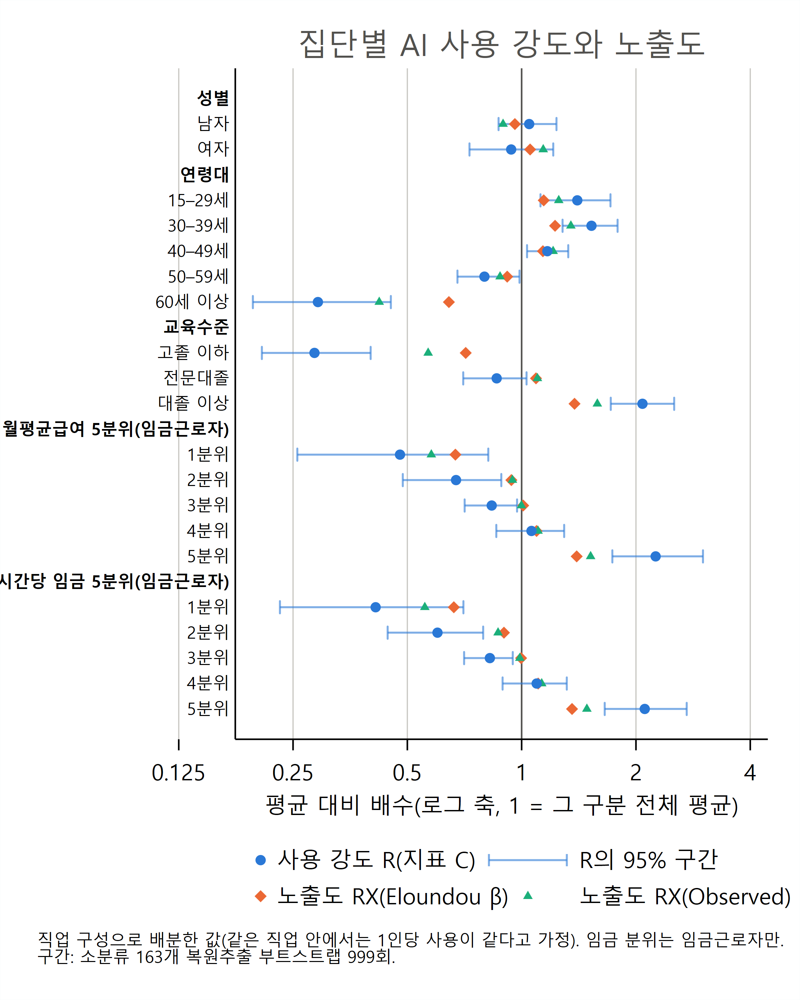
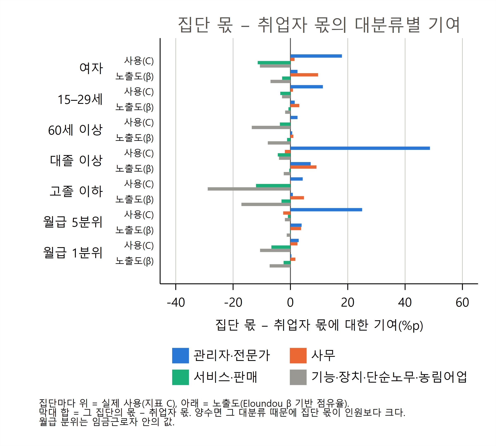

# 집단별 AI 사용과 노출도

**성별, 연령대, 교육수준, 임금수준(월평균급여·시간당 임금)**

AI-effects 프로젝트

> 이 문서는 같은 이름의 `.tex`와 같은 내용이다. 표 수치는 `results/table/`의 표 파일을 옮긴 것이다.

## 요약

직업(KSCO 8차 소분류) 단위로 만든 AI 사용 점유율 지표 A·B·C(paper 27)와 노출도 3개(Felten AIOE(Felten et al., 2023), Eloundou β(Eloundou et al., 2023), Observed Exposure(Massenkoff and McCrory, 2026))를 지역별고용조사 2022년 상반기의 직업 × 집단 취업자 구성으로 성별·연령대·교육수준·임금수준 집단에 나누어 비교했다. AEI는 사용자의 인구 특성을 공개하지 않으므로, 같은 직업 안에서는 집단과 관계없이 1인당 사용이 같다고 가정한다. 따라서 아래의 집단 차이는 모두 직업 구성의 차이에서 나온다. 임금 집단은 임금근로자만 대상으로 하고, 교차 집단과 OpenAI Signals 대조는 이번 작업에서 뺐다.

- **교육과 임금에 따른 차이가 가장 크다.** 취업자 가중 평균을 1로 둔 사용 강도 R(지표 C)은 대졸 이상 2.08, 고졸 이하 0.28이다. 대졸 이상은 취업자의 35.5%인데 사용의 73.8%를 차지한다. 월평균급여 5분위의 R은 2.25(1분위 0.48), 시간당 임금 5분위는 2.11(1분위 0.41)이다.
- **연령은 30대에서 가장 높고 60세 이상에서 크게 낮다.** R은 15~29세 1.40, 30~39세 1.53, 40~49세 1.17, 50~59세 0.80, 60세 이상 0.29다.
- **성별 차이는 작다.** R은 남자 1.05, 여자 0.94이고 구간이 서로 겹친다. 다만 노출도는 여자가 조금 높아(Eloundou β 1.05, Observed 1.14), 노출도에 비해서는 여자의 사용이 낮은 편이다(로그 거리 −0.11, 구간은 0 포함).
- **사용의 집단 차이는 노출도의 차이보다 크다.** 예를 들어 대졸 이상의 상대 노출도는 1.38(β)·1.58(OE)이지만 사용 강도는 2.08이고, 고졸 이하는 노출도 0.71·0.57에 사용 0.28이다. 사용이 노출도의 몇 배인지를 나타내는 로그 거리는 대졸 이상 +0.41, 고졸 이하 −0.92, 60세 이상 −0.79, 월급 5분위 +0.48이다.
- **차이는 대부분 전문가 대분류에서 나온다.** 대졸 이상의 사용 몫이 취업자 몫보다 38.3%p 큰데, 그중 43.1%p가 전문가 대분류다. 노출도 기준으로는 13.4%p 크고 사무 대분류의 기여(9.1%p)가 전문가(6.5%p)만큼 크다.

## 자료와 집단

- **집단 자료**: 지역별고용조사 2022년 상반기(B형, 전국, 소분류) 개인 자료의 취업자. 가중치 `시도전국가중값`, 근로시간은 조사 주간의 주업 시간(일시휴직자 0시간), 월 환산 × 4.345(paper 25와 같음). 직업은 KSCO 8차 소분류 163개다.
- **성별**: 남자, 여자. **연령대**(5구간): 15~29세, 30~39세, 40~49세, 50~59세, 60세 이상.
- **교육수준**: 고졸 이하, 전문대졸, 대졸 이상. 졸업은 그 학력, 재학·중퇴·휴학·수료는 한 단계 아래로 보고, 4년제 대학 미졸업은 고졸, 대학원은 졸업 여부와 관계없이 대졸 이상이다. 통계청 `교육정도변환코드`와 같은 규칙임을 do 파일에서 확인했다.
- **임금수준**(임금근로자만): `최근3개월_월평균급여`(만 원)의 가중 5분위, 그리고 시간당 임금 = 월평균급여 / (주업시간 × 4.345)의 가중 5분위. 조사 주간에 일하지 않은 임금근로자(주업시간 0)는 시간당 임금이 없어 시간당 임금 분위에서 빠진다. 급여가 만 원 단위로 몰려 있어 월급 분위의 인원은 16~24%로 고르지 않다(표 1).

**표 1. 임금 5분위의 경계와 인원 비중(임금근로자, 가중)**

| 분위 | 월평균급여(만 원) | 비중(%) | 시간당 임금(원) | 비중(%) |
|---|---|---|---|---|
| 1분위 | 2~180 | 22.8 | 288~10,356 | 20.4 |
| 2분위 | 181~220 | 18.6 | 10,356~12,657 | 20.7 |
| 3분위 | 221~290 | 18.9 | 12,674~16,110 | 20.4 |
| 4분위 | 291~400 | 24.0 | 16,150~21,863 | 18.6 |
| 5분위 | 401~5,000 | 15.7 | 21,891~690,409 | 19.9 |

## 방법

직업 j, 집단 g의 취업자를 E_jg, 월 주업 근로시간을 H_jg라 하고, E_j와 H_j는 직업 전체의 값이다. 직업 점유율을 그 직업 안 집단 구성비대로 나누고, 구분(예: 성별) 안에서 합이 1이 되게 정규화한다.

A_g ∝ Σ_j A_j E_jg / E_j; B_g ∝ Σ_j B_j H_jg / H_j; C_g ∝ Σ_j C_j E_jg / E_j.

B는 절감 시간이라 근로시간 비중으로 나누고, 취업자 비중으로 나눈 값은 강건성으로 둔다. 임금 집단은 임금근로자에게 배분된 몫 안에서 다시 정규화한다.

- **사용 강도**: R^A_g = A_g / W_g, R^B_g = B_g / η_g, R^C_g = C_g / W_g. W_g는 집단의 취업자 비중, η_g는 근로시간 비중이다. 1이면 인원만큼 쓰고 2이면 두 배 쓴다. 취업자 가중 평균은 1이다.
- **노출도**: x̄_g = Σ_j E_jg x_j / Σ_j E_jg(취업자 가중 평균), 상대 노출도 RX_g = x̄_g / x̄. 이는 노출도 기반 점유율(paper 28) XS_g를 W_g로 나눈 것과 같다. Felten은 음수가 있어 차이 x̄_g - x̄만 쓴다.
- **로그 거리**: d_g = ln R_g - ln RX_g. 사용이 노출도의 e^d배다(paper 33·37의 집단판).
- **분해**: C_g - W_g = Σ_k Σ_j ∈ k (c_j - w_j) E_jg/E_j. k는 KSCO 대분류, c_j와 w_j는 그 구분 모집단 안의 사용·취업자 비중이다. 노출도 기반 점유율도 같은 식으로 나눈다.
- **구간**: 소분류 163개를 복원추출해 같은 계산을 999번 반복한 95% 백분위 구간(seed 20261025, paper 33과 같은 방식). 조사의 표본오차와 AEI 비중의 오차는 반영하지 않으므로, "어떤 직업이 표본에 들었느냐"에 대한 민감도로 읽는다.
- 사용 0인 소분류 34개(2026-11-01 결정)는 사용 0으로 들어간다. 집단 값에는 로그를 쓰지 않으므로 빼지 않는다.

## 결과

### 사용 강도와 노출도

**표 2. 집단별 사용(지표 C)과 노출도. R = 사용 강도, RX = 상대 노출도, d = ln R - ln RX. 대괄호는 부트스트랩 95% 구간**

| 집단 | 취업자(%) | C(%) | R | RX(β) | RX(OE) | d(β) | d(OE) |
|---|---|---|---|---|---|---|---|
| **성별** |  |  |  |  |  |  |  |
| · 남자 | 56.7 | 59.4 | 1.05 [0.87, 1.23] | 0.96 | 0.89 | +0.09 [-0.10, 0.26] | +0.16 |
| · 여자 | 43.3 | 40.6 | 0.94 [0.73, 1.21] | 1.05 | 1.14 | -0.11 [-0.36, 0.12] | -0.19 |
| **연령대** |  |  |  |  |  |  |  |
| · 15–29세 | 14.3 | 20.1 | 1.40 [1.12, 1.71] | 1.14 | 1.25 | +0.20 [0.03, 0.35] | +0.11 |
| · 30–39세 | 18.9 | 28.8 | 1.53 [1.28, 1.79] | 1.22 | 1.35 | +0.22 [0.09, 0.34] | +0.13 |
| · 40–49세 | 22.5 | 26.3 | 1.17 [1.03, 1.33] | 1.14 | 1.21 | +0.03 [-0.06, 0.12] | -0.03 |
| · 50–59세 | 23.6 | 18.8 | 0.80 [0.68, 0.99] | 0.92 | 0.88 | -0.14 [-0.28, 0.06] | -0.09 |
| · 60세 이상 | 20.8 | 6.0 | 0.29 [0.20, 0.45] | 0.64 | 0.42 | -0.79 [-1.13, -0.41] | -0.37 |
| **교육수준** |  |  |  |  |  |  |  |
| · 고졸 이하 | 50.9 | 14.5 | 0.28 [0.21, 0.40] | 0.71 | 0.57 | -0.92 [-1.23, -0.59] | -0.69 |
| · 전문대졸 | 13.6 | 11.7 | 0.86 [0.70, 1.03] | 1.09 | 1.10 | -0.24 [-0.43, -0.07] | -0.25 |
| · 대졸 이상 | 35.5 | 73.8 | 2.08 [1.72, 2.52] | 1.38 | 1.58 | +0.41 [0.27, 0.56] | +0.27 |
| **월평균급여 5분위(임금근로자)** |  |  |  |  |  |  |  |
| · 1분위 | 22.8 | 10.9 | 0.48 [0.26, 0.82] | 0.67 | 0.58 | -0.34 [-0.91, 0.10] | -0.19 |
| · 2분위 | 18.6 | 12.5 | 0.67 [0.49, 0.88] | 0.94 | 0.95 | -0.34 [-0.66, -0.06] | -0.34 |
| · 3분위 | 18.9 | 15.8 | 0.83 [0.71, 0.97] | 1.01 | 1.00 | -0.19 [-0.35, -0.04] | -0.18 |
| · 4분위 | 24.0 | 25.4 | 1.06 [0.86, 1.29] | 1.09 | 1.10 | -0.03 [-0.20, 0.11] | -0.04 |
| · 5분위 | 15.7 | 35.4 | 2.25 [1.73, 3.00] | 1.40 | 1.52 | +0.48 [0.24, 0.73] | +0.39 |
| **시간당 임금 5분위(임금근로자)** |  |  |  |  |  |  |  |
| · 1분위 | 20.4 | 8.4 | 0.41 [0.23, 0.70] | 0.66 | 0.56 | -0.47 [-1.04, -0.03] | -0.30 |
| · 2분위 | 20.7 | 12.4 | 0.60 [0.44, 0.79] | 0.90 | 0.87 | -0.40 [-0.69, -0.14] | -0.37 |
| · 3분위 | 20.4 | 16.8 | 0.82 [0.71, 0.95] | 1.00 | 0.99 | -0.19 [-0.34, -0.06] | -0.18 |
| · 4분위 | 18.6 | 20.3 | 1.10 [0.89, 1.31] | 1.11 | 1.13 | -0.01 [-0.17, 0.13] | -0.03 |
| · 5분위 | 19.9 | 42.0 | 2.11 [1.65, 2.72] | 1.36 | 1.49 | +0.44 [0.23, 0.65] | +0.35 |

**그림 1. 집단별 사용 강도 R(지표 C, 95% 구간)과 상대 노출도 RX(Eloundou β, Observed). 로그 축, 1 = 그 구분 전체 평균**

**교육.** 대졸 이상의 사용 강도는 2.08 [1.72, 2.52]로 평균의 두 배이고, 고졸 이하는 0.28 [0.21, 0.40]이다. 전문대졸은 0.86으로 평균에 조금 못 미친다. 노출도도 같은 방향이지만 폭이 훨씬 작다(대졸 이상 1.38·1.58, 고졸 이하 0.71·0.57). 그래서 로그 거리는 대졸 이상 +0.41, 고졸 이하 −0.92로, 고졸 이하의 사용은 Eloundou β가 예상하는 것의 약 40%(e^-0.92)다.

**임금.** 월평균급여와 시간당 임금 어느 쪽으로 나눠도 결과가 거의 같다. 사용 강도는 1분위 0.48·0.41에서 5분위 2.25·2.11로 분위가 오를수록 커진다. 5분위는 임금근로자의 16%·20%인데 사용의 35%·42%를 가진다. 노출도의 기울기는 완만해(1분위 0.67, 5분위 1.40; β 기준) 1~3분위는 로그 거리가 음수, 5분위는 +0.48·+0.44다. 1분위의 구간은 넓다(R [0.26, 0.82]). 저임금 집단의 사용이 몇 개 사무 직업(372 비서 및 사무 지원, 332 통계·데이터 사무원)에 몰려 있어(표 5), 그 직업이 표본에 드느냐에 따라 값이 크게 움직이기 때문으로 보인다.

**연령.** 사용 강도는 30대(1.53)가 가장 높고 20대 이하(1.40), 40대(1.17) 순이다. 50대는 0.80, 60세 이상은 0.29로 낮다. 노출도도 나이가 들수록 낮아지지만 폭이 작아, 60세 이상의 로그 거리는 −0.79 [−1.13, −0.41]다. 이 결과는 직업 구성만 반영한 것이다. 같은 직업 안에서도 젊은 층이 더 많이 쓴다면 실제 연령 차이는 이보다 크다.

**성별.** 사용 강도는 남자 1.05 [0.87, 1.23], 여자 0.94 [0.73, 1.21]로 구간이 겹친다. 노출도는 여자가 조금 높다(β 1.05, OE 1.14, Felten +0.16). 사무직 비중이 높기 때문이다. 그래서 노출도에 비한 사용은 여자가 낮은 편이지만(d −0.11·−0.19), 구간이 0을 포함한다.

### 지표 A·B·C와 배분 방식

**표 3. 근로시간 비중, 지표별 사용 강도, Felten AIOE 평균의 차이(집단 평균 − 전체 평균, 대괄호는 95% 구간)**

| 집단 | 근로시간(%) | R^A | R^B | R^B(취업자 배분) | R^C | Felten 차이 |
|---|---|---|---|---|---|---|
| **성별** |  |  |  |  |  |  |
| · 남자 | 60.2 | 1.05 | 1.02 | 1.07 | 1.05 | -0.12 [-0.21, -0.03] |
| · 여자 | 39.8 | 0.93 | 0.96 | 0.91 | 0.94 | +0.16 [0.04, 0.31] |
| **연령대** |  |  |  |  |  |  |
| · 15–29세 | 13.6 | 1.36 | 1.45 | 1.39 | 1.40 | +0.20 [0.07, 0.33] |
| · 30–39세 | 19.6 | 1.54 | 1.49 | 1.54 | 1.53 | +0.26 [0.15, 0.37] |
| · 40–49세 | 23.5 | 1.18 | 1.13 | 1.17 | 1.17 | +0.16 [0.08, 0.26] |
| · 50–59세 | 24.7 | 0.80 | 0.77 | 0.80 | 0.80 | -0.08 [-0.14, -0.02] |
| · 60세 이상 | 18.5 | 0.30 | 0.30 | 0.28 | 0.29 | -0.46 [-0.58, -0.29] |
| **교육수준** |  |  |  |  |  |  |
| · 고졸 이하 | 49.7 | 0.31 | 0.27 | 0.28 | 0.28 | -0.40 [-0.51, -0.30] |
| · 전문대졸 | 14.2 | 0.90 | 0.83 | 0.86 | 0.86 | +0.11 [-0.00, 0.21] |
| · 대졸 이상 | 36.1 | 2.03 | 2.07 | 2.09 | 2.08 | +0.53 [0.41, 0.67] |
| **월평균급여 5분위(임금근로자)** |  |  |  |  |  |  |
| · 1분위 | 15.3 | 0.45 | 0.48 | 0.43 | 0.48 | -0.33 [-0.50, -0.12] |
| · 2분위 | 19.9 | 0.69 | 0.63 | 0.65 | 0.67 | -0.07 [-0.19, 0.03] |
| · 3분위 | 20.9 | 0.87 | 0.77 | 0.83 | 0.83 | -0.03 [-0.12, 0.08] |
| · 4분위 | 26.5 | 1.08 | 1.00 | 1.08 | 1.06 | +0.07 [-0.06, 0.19] |
| · 5분위 | 17.3 | 2.20 | 2.17 | 2.33 | 2.25 | +0.49 [0.32, 0.67] |
| **시간당 임금 5분위(임금근로자)** |  |  |  |  |  |  |
| · 1분위 | 18.0 | 0.40 | 0.42 | 0.38 | 0.41 | -0.38 [-0.53, -0.20] |
| · 2분위 | 21.0 | 0.62 | 0.60 | 0.58 | 0.60 | -0.12 [-0.23, -0.03] |
| · 3분위 | 21.4 | 0.85 | 0.80 | 0.82 | 0.82 | -0.04 [-0.12, 0.06] |
| · 4분위 | 19.3 | 1.11 | 1.07 | 1.11 | 1.10 | +0.09 [-0.02, 0.21] |
| · 5분위 | 20.2 | 2.06 | 2.09 | 2.16 | 2.11 | +0.47 [0.31, 0.62] |

지표를 A(대화)·B(절감 시간)·C(취업자 환산) 중 무엇으로 하든, B를 근로시간과 취업자 중 무엇으로 배분하든 사용 강도의 차이는 대부분 0.1 이내다. 직업 단위에서 세 지표의 순위상관이 0.98 이상이므로(paper 27) 집단에서도 같은 결과가 나온다. Felten AIOE로 보면 여자와 젊은 층, 대졸 이상, 고임금이 평균보다 높게 노출된다. 여자의 Felten 차이(+0.16)는 구간이 0을 포함하지 않는다.

### 차이는 어느 직업에서 오는가

**표 4. 집단 몫 − 취업자 몫(%p)의 대분류별 기여: 사용(지표 C)과 노출도(Eloundou β 기반 점유율)**

| 대분류 | 여자 사용 | 여자 노출도 | 60세 이상 사용 | 60세 이상 노출도 | 대졸 이상 사용 | 대졸 이상 노출도 | 월급 5분위 사용 | 월급 5분위 노출도 |
|---|---|---|---|---|---|---|---|---|
| 1 관리자 | +1.4 | +0.1 | +1.2 | +0.1 | +5.6 | +0.5 | +5.2 | +0.5 |
| 2 전문가 및 관련 종사자 | +16.6 | +2.4 | +1.3 | +0.5 | +43.1 | +6.5 | +19.8 | +3.4 |
| 3 사무 종사자 | +1.4 | +9.6 | -0.0 | +1.0 | -1.9 | +9.1 | -2.5 | +3.7 |
| 4 서비스 종사자 | -7.0 | -3.1 | -2.3 | -1.1 | -2.2 | -0.7 | -0.5 | -0.1 |
| 5 판매 종사자 | -4.4 | +0.2 | -1.4 | -0.1 | -2.3 | +0.3 | -0.4 | -0.1 |
| 6 농림∙어업 숙련 종사자 | -2.0 | -1.1 | -3.8 | -2.1 | -0.4 | -0.2 | -0.0 | -0.0 |
| 7 기능원 및 관련 기능 종사자 | -0.6 | -0.6 | -1.3 | -1.0 | -1.0 | -0.7 | -0.8 | -0.5 |
| 8 장치∙기계 조작 및 조립 종사자 | -1.2 | -0.8 | -2.1 | -0.7 | -1.2 | -0.7 | -1.0 | -0.7 |
| 9 단순노무 종사자 | -6.8 | -4.5 | -6.3 | -4.1 | -1.3 | -0.7 | -0.0 | -0.0 |
| 합계(집단 몫 − 취업자 몫) | -2.7 | +2.3 | -14.7 | -7.4 | +38.3 | +13.4 | +19.7 | +6.2 |

**그림 2. 집단 몫 − 취업자 몫의 대분류별 기여(대분류 4묶음). 집단마다 위는 사용, 아래는 노출도**

- **대졸 이상**: 사용 몫이 취업자 몫보다 38.3%p 큰데, 전문가 대분류가 43.1%p, 관리자가 5.6%p를 더하고 나머지 대분류는 조금씩 뺀다. 노출도 기준으로는 13.4%p 크고, 사무(9.1%p)와 전문가(6.5%p)가 비슷하게 기여한다. 노출도는 사무직에도 높은 값을 주지만, 실제 사용은 전문가 직업에 몰려 있기 때문이다(paper 28·29와 같은 그림).
- **여자**: 사용 몫은 취업자 몫보다 2.7%p 작다. 전문가 대분류가 +16.6%p를 더하지만 서비스(−7.0), 단순노무(−6.8), 판매(−4.4)가 더 많이 뺀다. 노출도 기준으로는 오히려 2.3%p 크고, 그 대부분이 사무(+9.6%p)다.
- **60세 이상**: 사용 몫이 14.7%p 작다. 단순노무(−6.3), 농림어업(−3.8), 서비스(−2.3), 장치·기계 조작(−2.1)에 많이 몰려 있기 때문이다. 노출도 기준의 차이(−7.4%p)는 그 절반이다.
- **월급 5분위**: 사용 몫이 19.7%p 크고 전문가(19.8%p)와 관리자(5.2%p)에서 나온다. 노출도 기준으로는 6.2%p 크다.

### 집단 안 사용의 분포

**표 5. 집단 사용(지표 C) 중 몫이 큰 소분류 상위 3(괄호 = 집단 안 몫, %)과 집단 안 실효 직업 수(1/HHI)**

| 집단 | 1위 | 2위 | 3위 | 실효 직업 수 |
|---|---|---|---|---|
| **성별** |  |  |  |  |
| · 남자 | 222 컴퓨터 시스템 및 소프트웨어 전문가 (16.1) | 291 작가 및 언론 관련 전문가 (7.7) | 225 정보 시스템 및 웹 운영자 (6.8) | 19.6 |
| · 여자 | 291 작가 및 언론 관련 전문가 (16.0) | 372 비서 및 사무 지원 종사자 (10.4) | 332 통계‧데이터 관련 사무원 (8.7) | 16.3 |
| **연령대** |  |  |  |  |
| · 15–29세 | 222 컴퓨터 시스템 및 소프트웨어 전문가 (14.8) | 291 작가 및 언론 관련 전문가 (10.7) | 372 비서 및 사무 지원 종사자 (10.2) | 15.3 |
| · 30–39세 | 222 컴퓨터 시스템 및 소프트웨어 전문가 (14.3) | 291 작가 및 언론 관련 전문가 (12.9) | 283 상품 기획‧홍보 및 조사 전문가 (6.8) | 16.8 |
| · 40–49세 | 222 컴퓨터 시스템 및 소프트웨어 전문가 (12.7) | 291 작가 및 언론 관련 전문가 (11.1) | 225 정보 시스템 및 웹 운영자 (6.0) | 20.7 |
| · 50–59세 | 291 작가 및 언론 관련 전문가 (8.4) | 332 통계‧데이터 관련 사무원 (7.1) | 222 컴퓨터 시스템 및 소프트웨어 전문가 (5.5) | 31.3 |
| · 60세 이상 | 291 작가 및 언론 관련 전문가 (12.0) | 372 비서 및 사무 지원 종사자 (7.9) | 131 연구‧교육 및 법률 관련 관리자 (4.2) | 27.6 |
| **교육수준** |  |  |  |  |
| · 고졸 이하 | 372 비서 및 사무 지원 종사자 (17.0) | 332 통계‧데이터 관련 사무원 (8.4) | 291 작가 및 언론 관련 전문가 (6.3) | 18.7 |
| · 전문대졸 | 222 컴퓨터 시스템 및 소프트웨어 전문가 (13.1) | 372 비서 및 사무 지원 종사자 (9.0) | 225 정보 시스템 및 웹 운영자 (7.7) | 19.4 |
| · 대졸 이상 | 291 작가 및 언론 관련 전문가 (12.7) | 222 컴퓨터 시스템 및 소프트웨어 전문가 (12.5) | 283 상품 기획‧홍보 및 조사 전문가 (5.5) | 19.7 |
| **월평균급여 5분위(임금근로자)** |  |  |  |  |
| · 1분위 | 372 비서 및 사무 지원 종사자 (22.1) | 332 통계‧데이터 관련 사무원 (13.6) | 269 기타 교육 전문가 (10.0) | 10.0 |
| · 2분위 | 372 비서 및 사무 지원 종사자 (17.4) | 291 작가 및 언론 관련 전문가 (12.1) | 332 통계‧데이터 관련 사무원 (9.2) | 14.3 |
| · 3분위 | 222 컴퓨터 시스템 및 소프트웨어 전문가 (12.3) | 291 작가 및 언론 관련 전문가 (10.5) | 213 생명 및 자연과학 관련 시험원 (7.3) | 18.5 |
| · 4분위 | 222 컴퓨터 시스템 및 소프트웨어 전문가 (16.1) | 291 작가 및 언론 관련 전문가 (9.8) | 225 정보 시스템 및 웹 운영자 (6.6) | 17.7 |
| · 5분위 | 222 컴퓨터 시스템 및 소프트웨어 전문가 (14.9) | 225 정보 시스템 및 웹 운영자 (6.6) | 223 네트워크 및 정보 보안 전문가 (6.1) | 20.1 |
| **시간당 임금 5분위(임금근로자)** |  |  |  |  |
| · 1분위 | 372 비서 및 사무 지원 종사자 (23.2) | 332 통계‧데이터 관련 사무원 (16.3) | 291 작가 및 언론 관련 전문가 (9.7) | 9.6 |
| · 2분위 | 372 비서 및 사무 지원 종사자 (18.9) | 291 작가 및 언론 관련 전문가 (8.0) | 332 통계‧데이터 관련 사무원 (8.0) | 15.0 |
| · 3분위 | 222 컴퓨터 시스템 및 소프트웨어 전문가 (12.1) | 291 작가 및 언론 관련 전문가 (12.0) | 372 비서 및 사무 지원 종사자 (7.1) | 18.7 |
| · 4분위 | 222 컴퓨터 시스템 및 소프트웨어 전문가 (15.9) | 291 작가 및 언론 관련 전문가 (10.6) | 225 정보 시스템 및 웹 운영자 (6.2) | 17.7 |
| · 5분위 | 222 컴퓨터 시스템 및 소프트웨어 전문가 (14.4) | 225 정보 시스템 및 웹 운영자 (6.5) | 283 상품 기획‧홍보 및 조사 전문가 (5.8) | 21.1 |

거의 모든 집단에서 222 컴퓨터 시스템 및 소프트웨어 전문가와 291 작가 및 언론 관련 전문가가 상위에 든다. 남자는 222(16.1%), 여자는 291(16.0%)이 1위다. 고졸 이하와 저임금(월급·시간당 임금 1~2분위)에서는 372 비서 및 사무 지원 종사자가 1위이고, 332 통계·데이터 관련 사무원이 상위 3에 든다. 이 집단의 사용은 적은 수의 사무 직업에 몰려 있어 실효 직업 수가 10개 안팎으로 작다(월급 1분위 10.0, 시간당 임금 1분위 9.6). 50대(31.3)와 60세 이상(27.6)은 사용이 여러 직업에 퍼져 있다.

## 해석상 주의

1. **직업 구성만 반영한다.** 같은 직업 안에서는 성별·나이·학력·임금과 관계없이 1인당 사용이 같다고 가정했다. 같은 직업 안에서 젊은 층이나 고학력자가 더 많이 쓴다면 실제 집단 차이는 이 결과보다 크다. 반대 방향의 차이가 있다면 작다. AEI는 사용자 특성을 공개하지 않아 이 가정을 직접 점검할 수 없다(OpenAI Signals의 연령·성별 자료와의 대조는 이번 작업에서 뺐다).
2. **직업 지표의 한계를 물려받는다.** 소분류 점유율은 연계표 배분(paper 21)과 AEI 공개 범위에 따라 달라지고, 사용 0인 34개 소분류는 실제 사용이 없다기보다 공개되지 않은 것이다. 이들은 장치·기계 조작 직업에 많아 고연령·저학력 집단의 값을 낮추는 방향으로 작용할 수 있다.
3. **시점이 다르다.** 집단 구성은 2022년 상반기, 사용은 2026년 4·5월이다.
4. **임금 분위.** 월평균급여는 최근 3개월 평균이고 근로시간은 조사 주간 한 주이므로, 시간당 임금에는 측정 시점 차이에서 오는 잡음이 있다. 두 기준의 결과가 거의 같아 결론에는 영향이 작다.
5. **구간의 의미.** 구간은 소분류 표본 구성에 대한 민감도이고, 조사 표본오차는 반영하지 않았다. 집단을 나눌수록 칸이 작아지므로 교차 집단은 따로 다루지 않았다.

## 산출 파일

- 코드: `code/01_09_import_kostat_regional_groups.do`(지역별고용조사 2022 상반기 → 소분류 × 집단 취업자·근로시간, 임금 분위 경계), `code/04_22_analysis_kor_group_usage.do`(집단 지표, 부트스트랩, 분해, 표·그림). 둘 다 `00_master.do`에 포함.
- 가공 자료: `data/proc/macro/kostat_lfs_regional/kostat_lfs_regional_ksco3_groups.{dta,csv}`, `kostat_lfs_regional_wage_cuts.{dta,csv}`.
- 엑셀: `results/table/38_kor_group_usage.xlsx`. 시트 `groups`(집단별 모든 값과 구간, 지표 A·B의 로그 거리 포함), `cuts`(임금 분위 경계), `decomp`(모든 집단의 대분류 9개별 기여, OE 포함), `top`(집단마다 상위 5 소분류).
- 이 노트의 표: `results/table/38_main.tex`, `38_abc.tex`, `38_decomp.tex`, `38_top.tex`, `38_cuts.tex`.
- 그림: `results/figure/38_fig_group_R.{pdf,png}`, `38_fig_group_decomp.{pdf,png}`.
