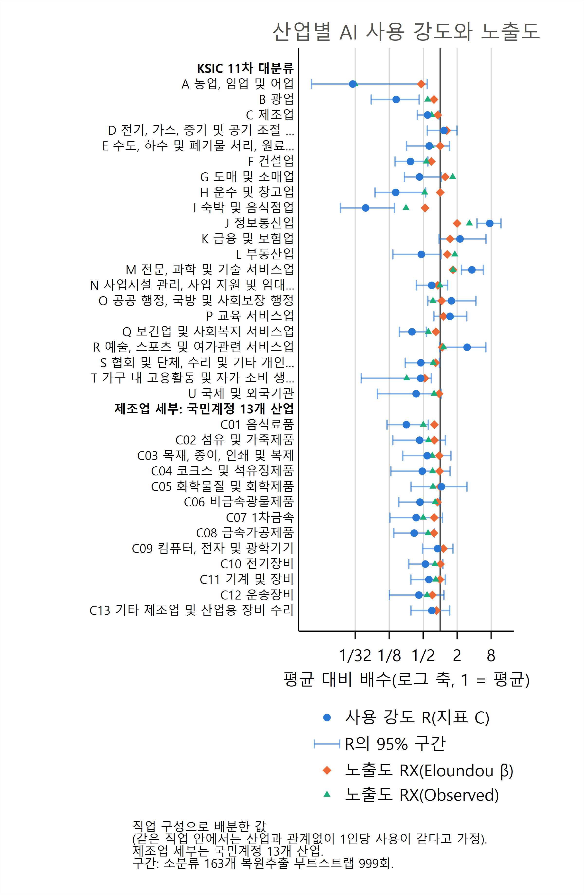
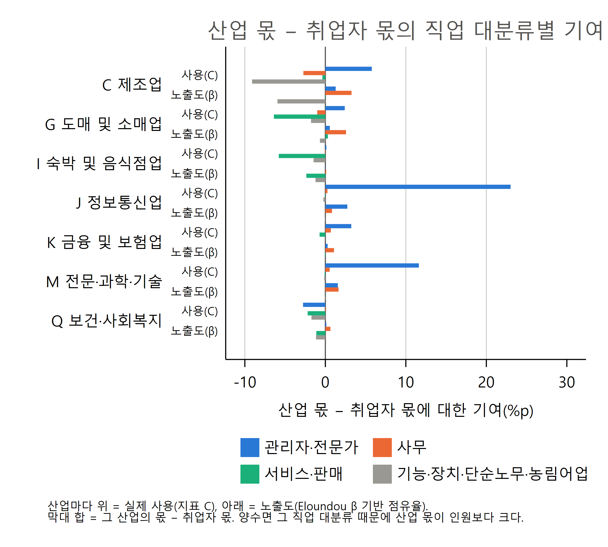

# 산업별 AI 사용과 노출도

**KSIC 11차 대분류와 국민계정 제조업 13개 산업**

AI-effects 프로젝트

> 이 문서는 같은 이름의 `.tex`와 같은 내용이다. 표 수치는 `results/table/`의 표 파일을 옮긴 것이다.

## 요약

paper 38의 집단 분석을 산업으로 넓혔다. 직업(KSCO 8차 소분류) 단위의 AI 사용 점유율 지표 A·B·C(paper 27)와 노출도 3개(Felten AIOE(Felten et al., 2023), Eloundou β(Eloundou et al., 2023), Observed Exposure(Massenkoff and McCrory, 2026))를 지역별고용조사 2022년 상반기의 직업 × 산업 취업자 구성으로 산업에 나누었다. 산업분류는 두 가지다. (1) 한국표준산업분류(KSIC) 11차 대분류 21개, (2) 제조업 밖은 KSIC 대분류, 제조업은 국민계정 13개 산업(C01~C13)인 33개다. AEI는 사용자의 산업을 공개하지 않으므로, 같은 직업 안에서는 산업과 관계없이 1인당 사용이 같다고 가정한다. 산업 차이는 모두 직업 구성의 차이다.

- **사용은 정보통신과 전문 서비스에 몰려 있다.** 취업자 가중 평균을 1로 둔 사용 강도 R(지표 C)은 J 정보통신업 7.58, M 전문·과학·기술 서비스업 3.66, R 예술·스포츠·여가 3.01, K 금융·보험업 2.26이다. 정보통신업은 취업자의 3.5%인데 사용의 26.5%를 가진다.
- **사용이 적은 산업**: A 농림어업(0.03), I 숙박·음식점업(0.05), H 운수·창고업(0.16), B 광업(0.17), F 건설업(0.30), Q 보건·사회복지(0.32), G 도소매업(0.43). 제조업은 0.60이다.
- **노출도에 비해서도 차이가 크다.** 노출도의 산업 차이는 사용보다 훨씬 작다(Eloundou β 0.46~2.00). 사용이 노출도의 몇 배인지를 나타내는 로그 거리는 J +1.33, M +0.77이고, I −2.43, H −1.82, L 부동산업 −1.06, G −1.05다. 도소매·부동산은 노출도가 평균보다 높은데 사용은 평균의 절반 아래다.
- **제조업 안에서는 차이가 작다.** 국민계정 13개 산업의 사용 강도는 0.25(C01 음식료품)~1.05(C05 화학물질 및 화학제품)이고, C05와 C09 컴퓨터·전자·광학기기(0.90)를 빼면 모두 0.75 아래다. 노출도도 0.73~1.15로 좁다.
- **차이는 대부분 전문가 직업의 비중에서 나온다.** 정보통신업의 사용 몫이 취업자 몫보다 23.0%p 큰데 그중 22.3%p가 전문가 대분류다. 제조업의 몫이 6.4%p 작은 것은 주로 장치·기계 조작(−5.4%p) 직업 때문이다.

## 산업분류와 방법

- **자료**: 지역별고용조사 2022년 상반기 취업자의 `3자리_11차산업소분류코드`(KSIC 11차 소분류). 코드 앞 두 자리(중분류)로 대분류를 정했다(A 01~03, B 05~08, C 10~34, D 35, E 36~39, F 41~42, G 45~47, H 49~52, I 55~56, J 58~63, K 64~66, L 68, M 70~73, N 74~76, O 84, P 85, Q 86~87, R 90~91, S 94~96, T 97~98, U 99). 취업자 모두 코드가 있다.
- **분류 (1)**: KSIC 11차 대분류 21개.
- **분류 (2)**: 제조업 밖은 KSIC 대분류 20개, 제조업은 국민계정 13개 산업. 대응은 한국은행 『우리나라의 국민계정체계(2025)』 <표 Ⅲ-2-6>·<표 Ⅲ-2-7>의 KSIC 코드를 중분류로 묶은 것이다: C01 음식료품 10~12, C02 섬유 및 가죽제품 13~15, C03 목재·종이·인쇄 및 복제 16~18, C04 코크스 및 석유정제품 19, C05 화학물질 및 화학제품 20~22(의약품, 고무·플라스틱 포함), C06 비금속광물제품 23, C07 1차금속 24, C08 금속가공제품 25, C09 컴퓨터·전자 및 광학기기 26~27, C10 전기장비 28, C11 기계 및 장비 29, C12 운송장비 30~31, C13 기타 제조업 및 산업용 장비 수리 32~34.
- 두 분류에서 제조업 밖 20개 산업의 값은 같다(do 파일에서 확인). 그래서 표는 분류 (1)의 21개와 분류 (2)의 제조업 13개만 싣는다. 분류 (2) 전체는 엑셀에 있다.
- **방법**: paper 38과 같다. 소분류 점유율을 산업 취업자(B는 근로시간) 구성비로 나눠 합 1로 정규화하고, 사용 강도 R = 산업 몫 / 취업자(근로시간) 비중, 상대 노출도 RX = 산업 취업자 가중 노출도 / 전체 평균, 로그 거리 d = ln R - ln RX를 구한다. 구간은 소분류 163개를 복원추출한 부트스트랩 999회의 95% 백분위 구간이다. 대상은 취업자 전체이고, 사용 0인 34개 소분류는 사용 0으로 들어간다.

## 결과

### 사용 강도와 노출도

**표 1. 산업별 사용(지표 C)과 노출도. R = 사용 강도, RX = 상대 노출도, d = ln R - ln RX. 대괄호는 부트스트랩 95% 구간**

| 산업 | 취업자(%) | C(%) | R | RX(β) | RX(OE) | d(β) | d(OE) |
|---|---|---|---|---|---|---|---|
| **KSIC 11차 대분류** |  |  |  |  |  |  |  |
| · A 농업, 임업 및 어업 | 5.5 | 0.2 | 0.03 [0.01, 0.59] | 0.46 | 0.03 | -2.79 [-4.54, -0.12] | -0.09 |
| · B 광업 | 0.0 | 0.0 | 0.17 [0.06, 0.43] | 0.78 | 0.60 | -1.54 [-2.36, -0.82] | -1.29 |
| · C 제조업 | 16.1 | 9.7 | 0.60 [0.40, 0.96] | 0.91 | 0.71 | -0.41 [-0.81, 0.04] | -0.17 |
| · D 전기, 가스, 증기 및 공기 조절 공급업 | 0.3 | 0.3 | 1.17 [0.59, 1.99] | 1.31 | 1.14 | -0.12 [-0.82, 0.44] | +0.03 |
| · E 수도, 하수 및 폐기물 처리, 원료 재생업 | 0.6 | 0.4 | 0.64 [0.25, 1.47] | 1.00 | 0.69 | -0.45 [-1.29, 0.33] | -0.08 |
| · F 건설업 | 7.6 | 2.3 | 0.30 [0.16, 0.61] | 0.70 | 0.57 | -0.85 [-1.36, -0.35] | -0.65 |
| · G 도매 및 소매업 | 11.9 | 5.1 | 0.43 [0.23, 1.05] | 1.23 | 1.67 | -1.05 [-1.56, -0.33] | -1.35 |
| · H 운수 및 창고업 | 5.9 | 1.0 | 0.16 [0.07, 0.56] | 1.01 | 0.53 | -1.82 [-2.62, -0.75] | -1.18 |
| · I 숙박 및 음식점업 | 7.5 | 0.4 | 0.05 [0.02, 0.16] | 0.54 | 0.25 | -2.43 [-3.41, -1.30] | -1.65 |
| · J 정보통신업 | 3.5 | 26.5 | 7.58 [4.49, 11.98] | 2.00 | 3.31 | +1.33 [0.92, 1.84] | +0.83 |
| · K 금융 및 보험업 | 2.5 | 5.7 | 2.26 [0.96, 6.48] | 1.51 | 2.22 | +0.40 [-0.29, 1.35] | +0.02 |
| · L 부동산업 | 1.9 | 0.9 | 0.47 [0.15, 1.03] | 1.34 | 1.82 | -1.06 [-2.04, -0.20] | -1.36 |
| · M 전문, 과학 및 기술 서비스업 | 4.5 | 16.4 | 3.66 [2.39, 5.85] | 1.69 | 1.70 | +0.77 [0.40, 1.21] | +0.77 |
| · N 사업시설 관리, 사업 지원 및 임대 서비스업 | 5.2 | 3.7 | 0.71 [0.38, 1.36] | 0.91 | 0.99 | -0.25 [-0.79, 0.27] | -0.33 |
| · O 공공 행정, 국방 및 사회보장 행정 | 4.6 | 7.3 | 1.59 [0.60, 4.30] | 1.07 | 0.75 | +0.40 [-0.50, 1.39] | +0.75 |
| · P 교육 서비스업 | 6.8 | 10.1 | 1.49 [0.77, 2.96] | 1.15 | 1.55 | +0.26 [-0.33, 0.91] | -0.04 |
| · Q 보건업 및 사회복지 서비스업 | 9.7 | 3.1 | 0.32 [0.19, 0.57] | 0.84 | 0.62 | -0.97 [-1.51, -0.42] | -0.67 |
| · R 예술, 스포츠 및 여가관련 서비스업 | 1.7 | 5.2 | 3.01 [0.98, 6.45] | 1.09 | 1.15 | +1.02 [-0.02, 1.65] | +0.96 |
| · S 협회 및 단체, 수리 및 기타 개인 서비스업 | 3.9 | 1.8 | 0.46 [0.24, 0.97] | 0.83 | 0.76 | -0.60 [-1.11, 0.01] | -0.51 |
| · T 가구 내 고용활동 및 자가 소비 생산활동 | 0.3 | 0.1 | 0.45 [0.04, 0.70] | 0.54 | 0.26 | -0.17 [-2.48, 0.23] | +0.57 |
| · U 국제 및 외국기관 | 0.0 | 0.0 | 0.38 [0.08, 1.04] | 0.96 | 0.78 | -0.94 [-2.36, 0.21] | -0.73 |
| **제조업 세부: 국민계정 13개 산업** |  |  |  |  |  |  |  |
| · C01 음식료품 | 1.6 | 0.4 | 0.25 [0.11, 0.62] | 0.79 | 0.50 | -1.14 [-1.80, -0.40] | -0.69 |
| · C02 섬유 및 가죽제품 | 1.2 | 0.5 | 0.43 [0.15, 1.24] | 0.79 | 0.62 | -0.60 [-1.61, 0.20] | -0.36 |
| · C03 목재, 종이, 인쇄 및 복제 | 0.7 | 0.4 | 0.59 [0.22, 1.55] | 0.97 | 0.73 | -0.49 [-1.47, 0.34] | -0.21 |
| · C04 코크스 및 석유정제품 | 0.1 | 0.0 | 0.48 [0.13, 1.50] | 0.98 | 0.74 | -0.70 [-1.80, 0.15] | -0.42 |
| · C05 화학물질 및 화학제품 | 2.0 | 2.1 | 1.05 [0.31, 2.99] | 0.99 | 0.75 | +0.06 [-1.09, 0.97] | +0.34 |
| · C06 비금속광물제품 | 0.4 | 0.2 | 0.44 [0.19, 0.98] | 0.90 | 0.82 | -0.72 [-1.40, -0.01] | -0.62 |
| · C07 1차금속 | 0.6 | 0.2 | 0.38 [0.13, 1.10] | 0.79 | 0.50 | -0.74 [-1.65, 0.12] | -0.29 |
| · C08 금속가공제품 | 1.4 | 0.5 | 0.35 [0.15, 0.79] | 0.78 | 0.61 | -0.81 [-1.55, -0.09] | -0.57 |
| · C09 컴퓨터, 전자 및 광학기기 | 2.3 | 2.1 | 0.90 [0.49, 1.69] | 1.15 | 0.92 | -0.24 [-0.69, 0.25] | -0.02 |
| · C10 전기장비 | 1.0 | 0.5 | 0.55 [0.28, 1.12] | 1.02 | 0.81 | -0.61 [-1.18, -0.03] | -0.39 |
| · C11 기계 및 장비 | 1.8 | 1.2 | 0.63 [0.30, 1.24] | 1.00 | 0.84 | -0.45 [-1.12, 0.15] | -0.28 |
| · C12 운송장비 | 2.1 | 0.9 | 0.42 [0.13, 1.17] | 0.73 | 0.59 | -0.55 [-1.50, 0.16] | -0.33 |
| · C13 기타 제조업 및 산업용 장비 수리 | 0.9 | 0.6 | 0.72 [0.30, 1.47] | 0.86 | 0.72 | -0.19 [-1.11, 0.52] | -0.00 |

**그림 1. 산업별 사용 강도 R(지표 C, 95% 구간)과 상대 노출도 RX(Eloundou β, Observed). 로그 축, 1 = 취업자 전체 평균**

**사용이 많은 산업.** J 정보통신업의 사용 강도는 7.58 [4.49, 11.98]로 평균의 7배를 넘는다. 노출도도 가장 높지만(β 2.00, OE 3.31) 사용이 그보다 훨씬 크다(d = +1.33). M 전문·과학·기술 서비스업(3.66)과 R 예술·스포츠·여가(3.01)가 뒤를 잇는다. K 금융·보험업(2.26), O 공공행정(1.59), P 교육(1.49)도 평균보다 높지만 구간이 넓다. 예를 들어 K의 구간은 [0.96, 6.48]이다. 이 산업들의 사용이 소수 직업(표 4)에 기대고 있어, 그 직업이 표본에 드느냐에 따라 값이 크게 움직이기 때문으로 보인다.

**사용이 적은 산업.** A 농림어업(0.03), I 숙박·음식점업(0.05), H 운수·창고업(0.16), B 광업(0.17), F 건설업(0.30), Q 보건·사회복지(0.32)는 평균의 3분의 1에도 못 미친다. 노출도는 이보다 덜 낮아서 로그 거리가 크게 음수다(I −2.43, A −2.79, H −1.82). G 도소매업(사용 0.43, 노출도 1.23·1.67)과 L 부동산업(0.47, 1.34·1.82)은 노출도가 평균보다 높은데 사용은 평균의 절반 아래다. 판매·중개 직업이 많아 노출도는 높게 잡히지만 실제 업무용 대화는 적다는 직업 단위 결과(paper 28·29)가 산업에서도 나타난다.

**제조업.** 제조업 전체의 사용 강도는 0.60 [0.40, 0.96], 노출도는 0.91(β)·0.71(OE)이다. 국민계정 13개 산업으로 나누면 C05 화학물질 및 화학제품(1.05)과 C09 컴퓨터·전자 및 광학기기(0.90)가 가장 높고, C01 음식료품(0.25), C08 금속가공제품(0.35), C07 1차금속(0.38)이 가장 낮다. 노출도의 폭(0.73~1.15)이 좁아 제조업 안의 차이는 산업 간 차이에 비해 작다. 구간이 대부분 겹치므로 제조업 세부 순위는 조심해서 읽어야 한다.

### 지표 A·B·C와 배분 방식

**표 2. 근로시간 비중, 지표별 사용 강도, Felten AIOE 평균의 차이(산업 평균 − 전체 평균, 대괄호는 95% 구간)**

| 산업 | 근로시간(%) | R^A | R^B | R^B(취업자 배분) | R^C | Felten 차이 |
|---|---|---|---|---|---|---|
| **KSIC 11차 대분류** |  |  |  |  |  |  |
| · A 농업, 임업 및 어업 | 5.0 | 0.03 | 0.03 | 0.03 | 0.03 | -0.83 [-1.04, -0.56] |
| · B 광업 | 0.1 | 0.17 | 0.16 | 0.17 | 0.17 | -0.51 [-0.83, 0.09] |
| · C 제조업 | 17.3 | 0.58 | 0.59 | 0.63 | 0.60 | -0.31 [-0.54, -0.06] |
| · D 전기, 가스, 증기 및 공기 조절 공급업 | 0.3 | 1.22 | 1.17 | 1.23 | 1.17 | +0.26 [-0.09, 0.59] |
| · E 수도, 하수 및 폐기물 처리, 원료 재생업 | 0.6 | 0.58 | 0.64 | 0.66 | 0.64 | -0.24 [-0.49, 0.15] |
| · F 건설업 | 7.8 | 0.32 | 0.31 | 0.31 | 0.30 | -0.58 [-0.89, -0.11] |
| · G 도매 및 소매업 | 12.6 | 0.50 | 0.42 | 0.44 | 0.43 | +0.44 [0.21, 0.87] |
| · H 운수 및 창고업 | 6.5 | 0.19 | 0.15 | 0.17 | 0.16 | -0.35 [-0.57, 0.24] |
| · I 숙박 및 음식점업 | 7.8 | 0.07 | 0.05 | 0.05 | 0.05 | -0.38 [-0.61, -0.10] |
| · J 정보통신업 | 3.6 | 7.60 | 7.64 | 7.72 | 7.58 | +0.75 [0.47, 0.97] |
| · K 금융 및 보험업 | 2.6 | 2.52 | 2.35 | 2.36 | 2.26 | +0.92 [0.63, 1.22] |
| · L 부동산업 | 2.0 | 0.50 | 0.48 | 0.48 | 0.47 | +0.38 [-0.31, 0.92] |
| · M 전문, 과학 및 기술 서비스업 | 4.6 | 3.35 | 3.58 | 3.71 | 3.66 | +0.72 [0.53, 0.91] |
| · N 사업시설 관리, 사업 지원 및 임대 서비스업 | 5.3 | 0.85 | 0.68 | 0.71 | 0.71 | -0.25 [-0.51, 0.14] |
| · O 공공 행정, 국방 및 사회보장 행정 | 4.1 | 1.38 | 1.71 | 1.55 | 1.59 | -0.04 [-0.45, 0.37] |
| · P 교육 서비스업 | 5.8 | 1.28 | 1.47 | 1.32 | 1.49 | +0.77 [0.37, 0.99] |
| · Q 보건업 및 사회복지 서비스업 | 8.1 | 0.39 | 0.36 | 0.31 | 0.32 | +0.08 [-0.18, 0.36] |
| · R 예술, 스포츠 및 여가관련 서비스업 | 1.6 | 3.31 | 2.93 | 2.93 | 3.01 | +0.19 [-0.01, 0.43] |
| · S 협회 및 단체, 수리 및 기타 개인 서비스업 | 4.1 | 0.50 | 0.44 | 0.45 | 0.46 | -0.00 [-0.37, 0.47] |
| · T 가구 내 고용활동 및 자가 소비 생산활동 | 0.2 | 0.28 | 0.45 | 0.32 | 0.45 | -0.18 [-0.53, 0.03] |
| · U 국제 및 외국기관 | 0.0 | 0.43 | 0.15 | 0.38 | 0.38 | -0.09 [-0.52, 0.20] |
| **제조업 세부: 국민계정 13개 산업** |  |  |  |  |  |  |
| · C01 음식료품 | 1.7 | 0.24 | 0.25 | 0.27 | 0.25 | -0.38 [-0.64, 0.05] |
| · C02 섬유 및 가죽제품 | 1.3 | 0.48 | 0.43 | 0.45 | 0.43 | -0.46 [-0.72, 0.17] |
| · C03 목재, 종이, 인쇄 및 복제 | 0.7 | 0.57 | 0.55 | 0.58 | 0.59 | -0.34 [-0.67, 0.25] |
| · C04 코크스 및 석유정제품 | 0.1 | 0.45 | 0.48 | 0.50 | 0.48 | -0.20 [-0.58, 0.48] |
| · C05 화학물질 및 화학제품 | 2.1 | 0.88 | 1.05 | 1.09 | 1.05 | -0.24 [-0.57, 0.33] |
| · C06 비금속광물제품 | 0.5 | 0.43 | 0.42 | 0.45 | 0.44 | -0.29 [-0.65, 0.17] |
| · C07 1차금속 | 0.6 | 0.34 | 0.37 | 0.40 | 0.38 | -0.50 [-0.86, 0.07] |
| · C08 금속가공제품 | 1.5 | 0.36 | 0.34 | 0.36 | 0.35 | -0.48 [-0.78, 0.01] |
| · C09 컴퓨터, 전자 및 광학기기 | 2.5 | 0.92 | 0.90 | 0.95 | 0.90 | -0.04 [-0.39, 0.37] |
| · C10 전기장비 | 1.1 | 0.53 | 0.53 | 0.58 | 0.55 | -0.15 [-0.45, 0.24] |
| · C11 기계 및 장비 | 2.0 | 0.62 | 0.63 | 0.67 | 0.63 | -0.21 [-0.53, 0.19] |
| · C12 운송장비 | 2.3 | 0.43 | 0.42 | 0.45 | 0.42 | -0.46 [-0.77, 0.01] |
| · C13 기타 제조업 및 산업용 장비 수리 | 0.9 | 0.71 | 0.68 | 0.74 | 0.72 | -0.39 [-0.65, -0.02] |

지표와 배분 방식을 바꿔도 사용 강도의 순서는 거의 같다. 차이가 가장 큰 곳은 O 공공행정(R^A 1.38, R^B 1.71)과 R 예술·스포츠·여가(3.31, 2.93)처럼 대화당 절감 시간이 평균과 다른 직업이 많은 산업이다. Felten AIOE로 보면 K 금융·보험(+0.92), P 교육(+0.77), J 정보통신(+0.75), M 전문서비스(+0.72)가 높고, A 농림어업(−0.83), F 건설(−0.58)이 낮다. P 교육은 Felten 차이가 큰 데 비해 Eloundou 노출도는 1.15로 평균에 가깝다.

### 차이는 어느 직업에서 오는가

**표 3. 산업 몫 − 취업자 몫(%p)의 직업 대분류별 기여: 사용(지표 C)과 노출도(Eloundou β 기반 점유율)**

| 직업 대분류 | C 제조업 사용 | C 제조업 노출도 | J 정보통신 사용 | J 정보통신 노출도 | M 전문·과학·기술 사용 | M 전문·과학·기술 노출도 | Q 보건·사회복지 사용 | Q 보건·사회복지 노출도 |
|---|---|---|---|---|---|---|---|---|
| 1 관리자 | +1.1 | +0.1 | +0.7 | +0.0 | +0.7 | +0.0 | +0.2 | +0.0 |
| 2 전문가 및 관련 종사자 | +4.6 | +1.2 | +22.3 | +2.7 | +10.9 | +1.5 | -3.0 | +0.1 |
| 3 사무 종사자 | -2.7 | +3.3 | +0.3 | +0.8 | +0.5 | +1.6 | +0.1 | +0.6 |
| 4 서비스 종사자 | -0.1 | -0.0 | -0.0 | -0.0 | -0.0 | -0.0 | -2.2 | -1.1 |
| 5 판매 종사자 | -0.3 | -0.0 | -0.1 | +0.0 | -0.0 | -0.0 | -0.0 | +0.0 |
| 6 농림∙어업 숙련 종사자 | -0.0 | -0.0 | 0.0 | 0.0 | -0.0 | -0.0 | -0.0 | -0.0 |
| 7 기능원 및 관련 기능 종사자 | -2.2 | -1.5 | -0.1 | -0.0 | -0.1 | -0.0 | +0.0 | -0.0 |
| 8 장치∙기계 조작 및 조립 종사자 | -5.4 | -3.7 | -0.0 | -0.0 | -0.0 | -0.0 | -0.1 | -0.0 |
| 9 단순노무 종사자 | -1.5 | -0.8 | -0.1 | -0.0 | -0.0 | -0.0 | -1.6 | -1.1 |
| 합계(산업 몫 − 취업자 몫) | -6.4 | -1.5 | +23.0 | +3.5 | +11.9 | +3.1 | -6.6 | -1.5 |

**그림 2. 산업 몫 − 취업자 몫의 직업 대분류별 기여(대분류 4묶음). 산업마다 위는 사용, 아래는 노출도**

- **J 정보통신업**: 사용 몫이 취업자 몫보다 23.0%p 크고, 그중 22.3%p가 전문가 대분류(컴퓨터 시스템·소프트웨어 전문가, 작가·언론 등)다. 노출도 기준으로는 3.5%p 클 뿐이다.
- **M 전문·과학·기술 서비스업**: 사용 몫이 11.9%p 크고 거의 모두(10.9%p) 전문가다. 노출도 기준은 3.1%p다.
- **C 제조업**: 사용 몫이 6.4%p 작다. 전문가(엔지니어·시험원)가 +4.6%p를 더하지만 장치·기계 조작(−5.4), 사무(−2.7), 기능원(−2.2), 단순노무(−1.5)가 더 많이 뺀다. 노출도 기준으로는 −1.5%p이고 사무가 +3.3%p를 더한다.
- **Q 보건·사회복지**: 사용 몫이 6.6%p 작다. 전문가 대분류도 −3.0%p다. 간호사 등 보건 전문직의 사용이 적기 때문이다(paper 29·33). 서비스(−2.2)와 단순노무(−1.6)가 나머지를 뺀다.

### 산업 안 사용의 분포

**표 4. 산업 사용(지표 C) 중 몫이 큰 소분류 상위 3(괄호 = 산업 안 몫, %)과 산업 안 실효 직업 수(1/HHI)**

| 산업 | 1위 | 2위 | 3위 | 실효 직업 수 |
|---|---|---|---|---|
| **KSIC 11차 대분류** |  |  |  |  |
| · A 농업, 임업 및 어업 | 213 생명 및 자연과학 관련 시험원 (48.7) | 332 통계‧데이터 관련 사무원 (9.7) | 149 기타 건설‧전기 및 생산 관련 관리자 (9.4) | 3.7 |
| · B 광업 | 141 건설‧전기 및 생산 관련 관리자 (25.4) | 372 비서 및 사무 지원 종사자 (14.6) | 239 기타 공학 전문가 및 관련 종사자 (13.7) | 7.6 |
| · C 제조업 | 213 생명 및 자연과학 관련 시험원 (10.6) | 235 기계‧로봇공학 기술자 및 시험원 (9.2) | 222 컴퓨터 시스템 및 소프트웨어 전문가 (7.5) | 20.7 |
| · D 전기, 가스, 증기 및 공기 조절 공급업 | 861 발전 및 배전 장치 조작원 (31.0) | 852 냉난방 관련 설비 조작원 (10.7) | 236 소방‧방재‧산업안전 기술자 및 시험원 (9.4) | 7.3 |
| · E 수도, 하수 및 폐기물 처리, 원료 재생업 | 153 환경‧청소 및 경비 관련 관리자 (24.7) | 149 기타 건설‧전기 및 생산 관련 관리자 (21.9) | 237 환경공학‧가스‧에너지 기술자 및 시험원 (12.8) | 7.0 |
| · F 건설업 | 141 건설‧전기 및 생산 관련 관리자 (18.5) | 236 소방‧방재‧산업안전 기술자 및 시험원 (9.1) | 372 비서 및 사무 지원 종사자 (6.8) | 14.7 |
| · G 도매 및 소매업 | 283 상품 기획‧홍보 및 조사 전문가 (18.9) | 372 비서 및 사무 지원 종사자 (16.7) | 225 정보 시스템 및 웹 운영자 (6.5) | 11.5 |
| · H 운수 및 창고업 | 225 정보 시스템 및 웹 운영자 (23.2) | 372 비서 및 사무 지원 종사자 (15.1) | 151 판매 및 운송 관리자 (9.2) | 9.9 |
| · I 숙박 및 음식점업 | 152 고객 서비스 관리자 (28.7) | 283 상품 기획‧홍보 및 조사 전문가 (11.8) | 122 마케팅 및 광고‧홍보 관리자 (11.5) | 7.5 |
| · J 정보통신업 | 222 컴퓨터 시스템 및 소프트웨어 전문가 (36.7) | 291 작가 및 언론 관련 전문가 (22.3) | 225 정보 시스템 및 웹 운영자 (10.0) | 4.8 |
| · K 금융 및 보험업 | 282 금융 및 보험 전문가 (36.4) | 340 금융 사무 종사자 (26.0) | 225 정보 시스템 및 웹 운영자 (8.3) | 4.6 |
| · L 부동산업 | 284 감정‧기술 영업 및 중개 관련 종사자 (34.2) | 139 기타 전문 서비스 관리자 (32.6) | 372 비서 및 사무 지원 종사자 (8.5) | 4.2 |
| · M 전문, 과학 및 기술 서비스업 | 291 작가 및 언론 관련 전문가 (12.7) | 283 상품 기획‧홍보 및 조사 전문가 (11.0) | 211 생명 및 자연과학 관련 전문가 (10.1) | 16.0 |
| · N 사업시설 관리, 사업 지원 및 임대 서비스업 | 283 상품 기획‧홍보 및 조사 전문가 (20.9) | 372 비서 및 사무 지원 종사자 (8.4) | 522 상품 대여 종사자 (8.1) | 12.7 |
| · O 공공 행정, 국방 및 사회보장 행정 | 332 통계‧데이터 관련 사무원 (31.2) | 372 비서 및 사무 지원 종사자 (15.8) | 213 생명 및 자연과학 관련 시험원 (12.5) | 6.6 |
| · P 교육 서비스업 | 264 문리‧기술 및 예능 강사 (25.6) | 269 기타 교육 전문가 (17.6) | 261 대학교수 및 강사 (12.8) | 7.3 |
| · Q 보건업 및 사회복지 서비스업 | 372 비서 및 사무 지원 종사자 (13.3) | 246 치료‧재활사 및 의료기사 (10.6) | 291 작가 및 언론 관련 전문가 (9.6) | 15.9 |
| · R 예술, 스포츠 및 여가관련 서비스업 | 291 작가 및 언론 관련 전문가 (34.0) | 292 학예사‧사서 및 기록물 관리사 (21.0) | 298 문화‧예술 관련 기획자 (14.6) | 5.1 |
| · S 협회 및 단체, 수리 및 기타 개인 서비스업 | 372 비서 및 사무 지원 종사자 (13.3) | 291 작가 및 언론 관련 전문가 (9.9) | 149 기타 건설‧전기 및 생산 관련 관리자 (7.5) | 18.9 |
| · T 가구 내 고용활동 및 자가 소비 생산활동 | 951 가사 및 육아 도우미 (96.7) | 264 문리‧기술 및 예능 강사 (2.2) | 421 교사 보조 및 아동 돌봄 종사자 (0.6) | 1.1 |
| · U 국제 및 외국기관 | 283 상품 기획‧홍보 및 조사 전문가 (61.9) | 352 정부 행정 사무 종사자 (17.5) | 371 총무 사무원 및 대학 행정조교 (9.4) | 2.4 |
| **제조업 세부: 국민계정 13개 산업** |  |  |  |  |
| · C01 음식료품 | 239 기타 공학 전문가 및 관련 종사자 (17.0) | 121 행정 및 경영 지원 관리자 (10.5) | 141 건설‧전기 및 생산 관련 관리자 (8.8) | 13.0 |
| · C02 섬유 및 가죽제품 | 283 상품 기획‧홍보 및 조사 전문가 (44.0) | 721 섬유 및 가죽 관련 기능 종사자 (14.4) | 295 디자이너 (13.8) | 4.2 |
| · C03 목재, 종이, 인쇄 및 복제 | 291 작가 및 언론 관련 전문가 (29.6) | 122 마케팅 및 광고‧홍보 관리자 (19.1) | 799 기타 기능 관련 종사자 (9.3) | 6.7 |
| · C04 코크스 및 석유정제품 | 271 법률 전문가 (29.2) | 121 행정 및 경영 지원 관리자 (16.6) | 372 비서 및 사무 지원 종사자 (14.6) | 6.0 |
| · C05 화학물질 및 화학제품 | 213 생명 및 자연과학 관련 시험원 (46.5) | 211 생명 및 자연과학 관련 전문가 (16.4) | 332 통계‧데이터 관련 사무원 (4.1) | 4.0 |
| · C06 비금속광물제품 | 233 금속‧재료공학 기술자 및 시험원 (21.9) | 121 행정 및 경영 지원 관리자 (10.4) | 141 건설‧전기 및 생산 관련 관리자 (9.7) | 10.4 |
| · C07 1차금속 | 233 금속‧재료공학 기술자 및 시험원 (31.5) | 121 행정 및 경영 지원 관리자 (11.6) | 141 건설‧전기 및 생산 관련 관리자 (6.1) | 7.3 |
| · C08 금속가공제품 | 239 기타 공학 전문가 및 관련 종사자 (20.9) | 235 기계‧로봇공학 기술자 및 시험원 (11.7) | 225 정보 시스템 및 웹 운영자 (11.4) | 11.0 |
| · C09 컴퓨터, 전자 및 광학기기 | 222 컴퓨터 시스템 및 소프트웨어 전문가 (19.9) | 234 전기‧전자공학 기술자 및 시험원 (14.7) | 221 컴퓨터 하드웨어 및 통신공학 전문가 (8.3) | 11.0 |
| · C10 전기장비 | 222 컴퓨터 시스템 및 소프트웨어 전문가 (12.5) | 122 마케팅 및 광고‧홍보 관리자 (12.0) | 234 전기‧전자공학 기술자 및 시험원 (11.7) | 14.4 |
| · C11 기계 및 장비 | 235 기계‧로봇공학 기술자 및 시험원 (20.3) | 239 기타 공학 전문가 및 관련 종사자 (18.4) | 222 컴퓨터 시스템 및 소프트웨어 전문가 (11.0) | 9.6 |
| · C12 운송장비 | 235 기계‧로봇공학 기술자 및 시험원 (44.6) | 222 컴퓨터 시스템 및 소프트웨어 전문가 (8.3) | 239 기타 공학 전문가 및 관련 종사자 (8.2) | 4.5 |
| · C13 기타 제조업 및 산업용 장비 수리 | 730 목재‧가구‧악기 및 간판 관련 기능 종사자 (32.6) | 149 기타 건설‧전기 및 생산 관련 관리자 (26.3) | 295 디자이너 (8.1) | 5.2 |

산업 안 사용은 소수 직업에 몰려 있는 경우가 많다. 정보통신업은 222 컴퓨터 시스템 및 소프트웨어 전문가(36.7%)와 291 작가 및 언론 관련 전문가(22.3%)가 60%를 차지해 실효 직업 수가 4.8개다. 직업 연계의 영향이 그대로 보이는 산업도 있다. A 농림어업의 사용은 절반 가까이(48.7%)가 213 생명 및 자연과학 관련 시험원이고, C05 화학물질 및 화학제품도 46.5%가 이 직업이다. 213은 취업자가 1만 1천 명인데 데이터 과학자 등 SOC의 대화가 연계표로 많이 배분된 직업이다(paper 23·26). 산업 값에 이런 직업 하나가 크게 작용하므로, 사용 강도가 높게 나온 소규모 산업은 상위 직업을 함께 확인해야 한다.

## 해석상 주의

1. **직업 구성만 반영한다.** 같은 직업이면 어느 산업에서 일하든 1인당 사용이 같다고 가정했다. 같은 직업이라도 정보통신업 종사자가 제조업 종사자보다 더 많이 쓴다면 실제 산업 차이는 이보다 크다. AEI는 사용자의 산업을 공개하지 않아 이 가정을 점검할 수 없다.
2. **직업 지표의 한계를 물려받는다.** 소분류 점유율은 연계표 배분(paper 21)에 의존하고, 사용 0인 34개 소분류(장치·기계 조작 직업이 많음)는 공개되지 않은 것일 수 있다. 이 소분류들이 제조업·운수업 값을 낮추는 방향으로 작용할 수 있다.
3. **작은 산업.** U 국제 및 외국기관(표본 69명), T 가구 내 고용(386명), B 광업(252명), D 전기·가스(707명)는 표본이 작고 구간이 넓다. 이 구간은 소분류 구성에 대한 것이고 조사 표본오차는 들어 있지 않다.
4. **국민계정 대응의 범위.** 제조업 13개 산업은 KSIC 중분류 단위로 대응했다(한국은행 표의 소분류 구분은 모두 중분류 안에서 같은 산업으로 묶인다). 국민계정 산업분류에는 KSIC 대분류 U(국제 및 외국기관)가 없지만, 이번 분류 (2)는 제조업 밖을 KSIC 대분류로 두기로 했으므로 U를 따로 남겼다.
5. **시점.** 산업 구성은 2022년 상반기, 사용은 2026년 4·5월이다.

## 산출 파일

- 코드: `code/01_09_import_kostat_regional_groups.do`(산업 집단 ind1·ind2 추가), `code/04_23_analysis_kor_industry_usage.do`(산업 지표, 부트스트랩, 분해, 표·그림). 둘 다 `00_master.do`에 포함.
- 가공 자료: `data/proc/macro/kostat_lfs_regional/kostat_lfs_regional_ksco3_groups.{dta,csv}`(dim = ind1, ind2).
- 엑셀: `results/table/39_kor_industry_usage.xlsx`. 시트 `groups`(두 분류의 모든 산업과 구간), `decomp`(모든 산업의 직업 대분류 9개별 기여, OE 포함), `top`(산업마다 상위 5 소분류).
- 이 노트의 표: `results/table/39_main.tex`, `39_abc.tex`, `39_decomp.tex`, `39_top.tex`.
- 그림: `results/figure/39_fig_ind_R.{pdf,png}`, `39_fig_ind_decomp.{pdf,png}`.
